<picture>
  <source media="(prefers-color-scheme: dark)" srcset="docs/assets/banner-dark.svg">
  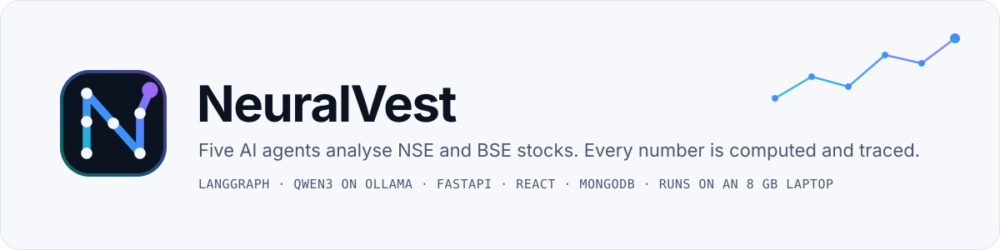
</picture>

<p align="center">
  
  
  
  
  
  
  <br>
  
  
  
  
</p>

<p align="center">
  <a href="#what-it-does">What it does</a> ·
  <a href="#screenshots">Screenshots</a> ·
  <a href="#how-it-works">How it works</a> ·
  <a href="#getting-started">Getting started</a> ·
  <a href="#api">API</a> ·
  <a href="#testing-and-performance">Testing</a> ·
  <a href="#documentation">Docs</a>
</p>

**NeuralVest** analyses stocks listed on the NSE and BSE. Five specialised agents (market research, financial news,
stock analysis, risk assessment and portfolio optimisation) are coordinated by a LangGraph supervisor and write one
report per request. Every figure is computed in Python from public end-of-day data. A small local language model
(Qwen3 through Ollama) only **explains** figures it is given, and every explanation is checked before you see it.

It runs entirely on a Windows laptop with **8 GB of RAM and no graphics card**, using free tools and the MongoDB Atlas
free tier.

> [!IMPORTANT]
> NeuralVest is an educational project. It is not registered with SEBI, its reports describe the past, and nothing
> in them is investment advice. Prices are end-of-day data from Yahoo Finance and can be delayed.

---

## What it does

| | |
|---|---|
| **Five agents, one report** | Market research (indicators, trend, comparison with the NIFTY 50), financial news (sentiment per article and a digest), stock analysis (ratios from the annual statements), risk assessment (volatility, beta, drawdown, Sharpe, correlation) and portfolio optimisation (weights, whole shares, backtest). |
| **Numbers you can check** | Every figure is computed by tested Python code, shown with its formula and data window, and traced to the agent that produced it. A report says how many of its numbers were traced (for example 125 of 125). |
| **An AI that is not allowed to guess** | The model receives computed facts and restates them. Answers with invented numbers, contradictions of a computed reading, a wrong gap to the NIFTY 50, or a fact on the wrong stock are rejected, retried, and if necessary replaced by rule based text, labelled as such. |
| **Illustrative portfolios** | Seven methods (max Sharpe, min volatility, efficient risk or return, equal weight, inverse volatility, hierarchical risk parity), risk preferences with weight limits, whole-share allocation for your amount, and a walk-forward backtest with costs against equal weights and the NIFTY 50. |
| **A full web app** | Accounts, market overview of NIFTY 50, SENSEX and 30 curated stocks, watchlist, live agent progress, saved reports with comparison and PDF export, dark and light themes, `Ctrl K` search. |
| **Built for small machines** | One model in memory at a time, the larger model only when RAM allows, agents in sequence by default, cached data, and a storage guard for the 512 MB database tier. |

---

## Screenshots

<!-- Screenshots go in docs/screenshots/<name>-dark.png and <name>-light.png. -->

<picture>
  <source media="(prefers-color-scheme: dark)" srcset="docs/screenshots/landing-dark.png">
  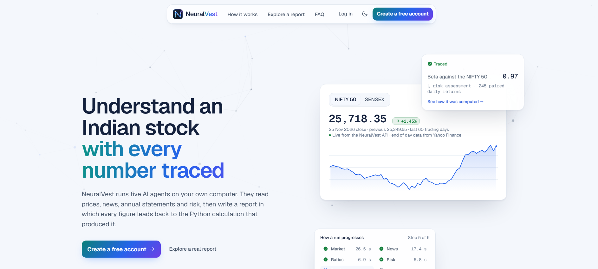
</picture>

<p align="center"><sub>The landing page, in the theme that matches your GitHub setting. Every module below shows both themes.</sub></p>

<details open>
<summary><b>Overview</b>: market overview, watchlist and your latest activity</summary>

| Dark | Light |
|---|---|
| 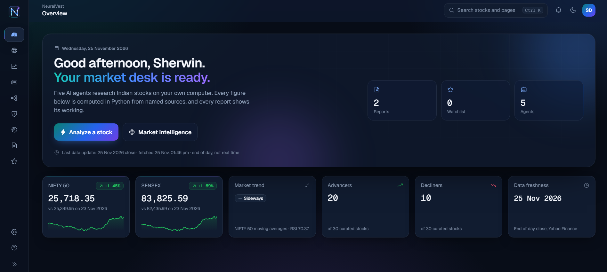 | 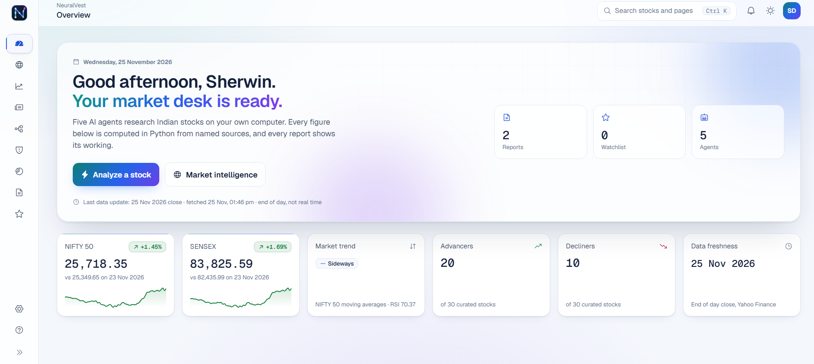 |
</details>

<details>
<summary><b>Stock analysis</b>: the report of the five agents</summary>

| Dark | Light |
|---|---|
| 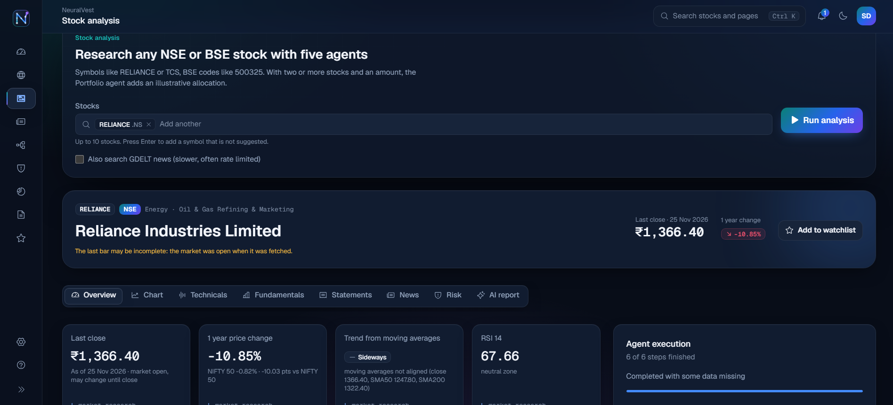 | 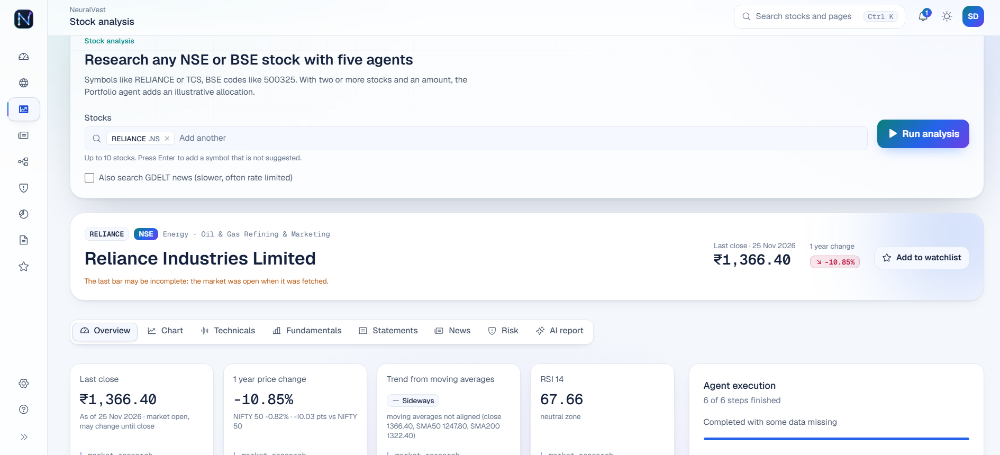 |
</details>

<details>
<summary><b>AI agents</b>: the agent network and each step of a run</summary>

| Dark | Light |
|---|---|
| 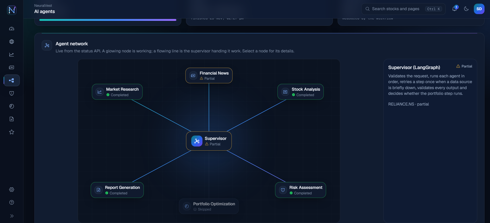 | 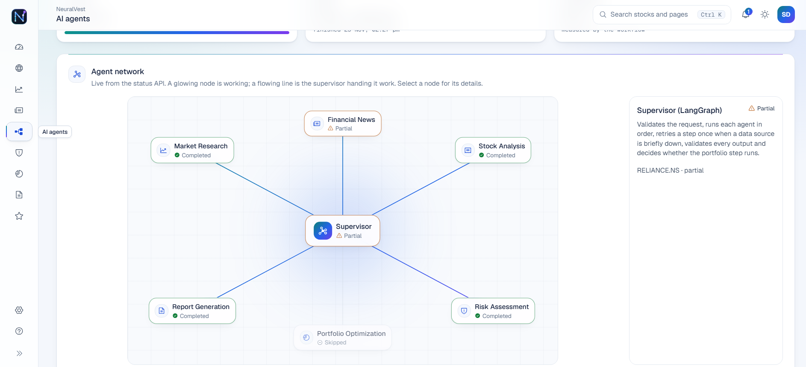 |
</details>

<details>
<summary><b>Market intelligence</b>: NIFTY 50, SENSEX and the 30 curated stocks</summary>

| Dark | Light |
|---|---|
| 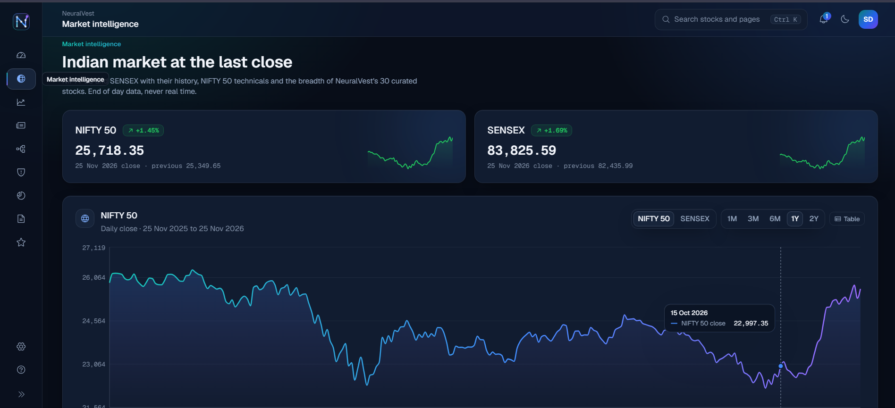 | 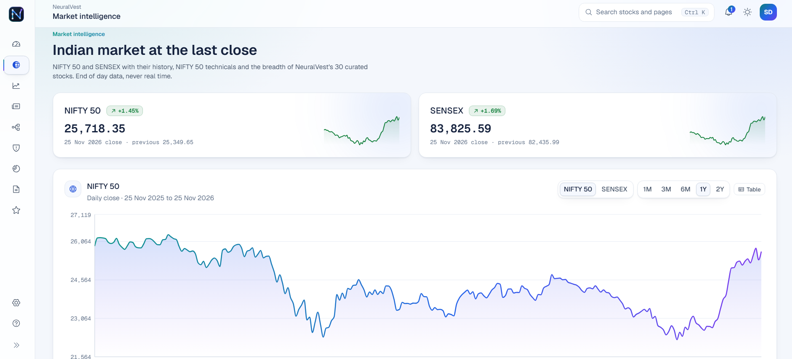 |
</details>

<details>
<summary><b>Financial news</b>: stored articles with AI sentiment</summary>

| Dark | Light |
|---|---|
|  |  |
</details>

<details>
<summary><b>Risk analysis</b>: volatility, drawdown, beta, Sharpe and correlation</summary>

| Dark | Light |
|---|---|
| 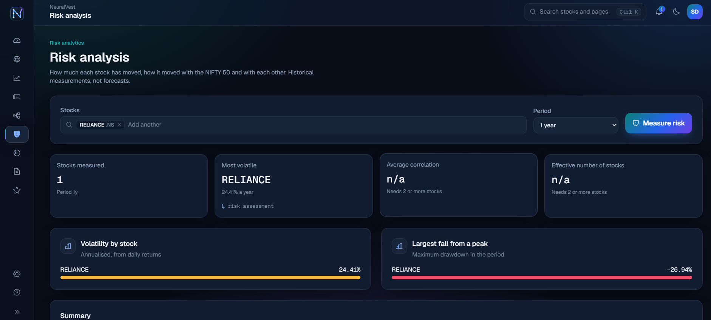 | 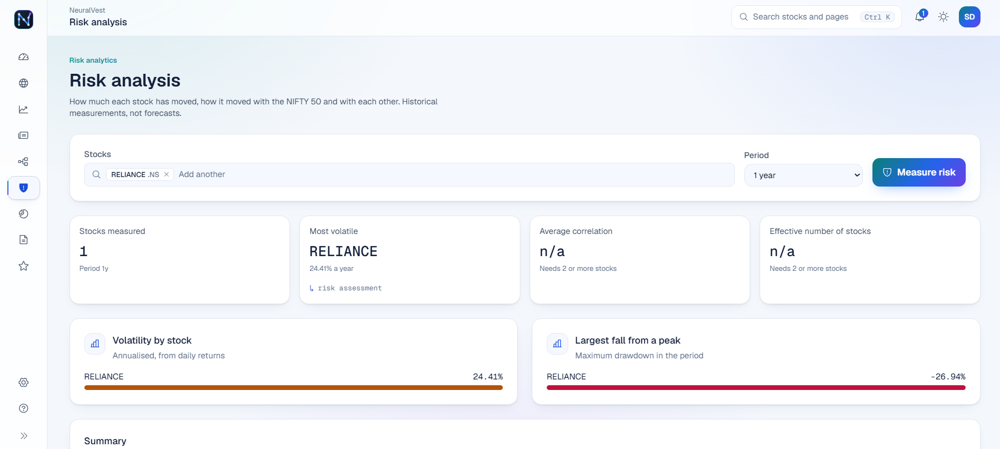 |
</details>

<details>
<summary><b>Portfolio optimisation</b>: allocation, whole shares and a backtest</summary>

| Dark | Light |
|---|---|
| 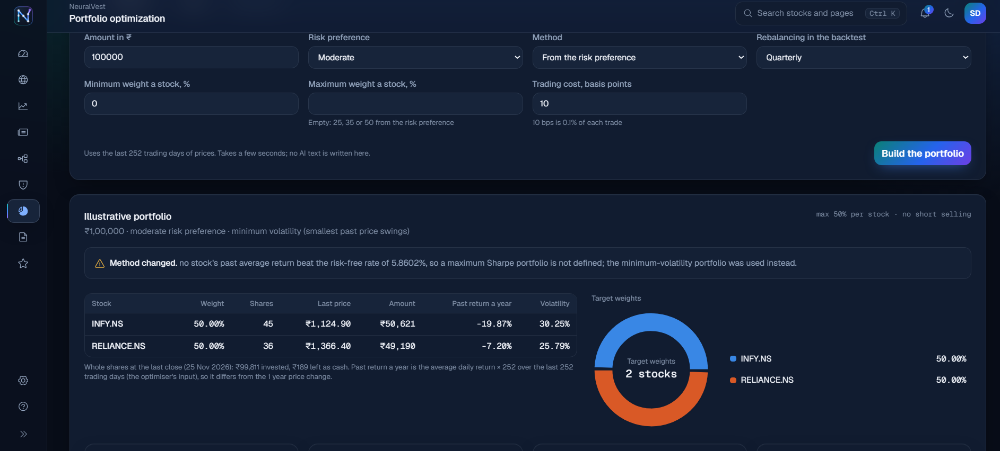 | 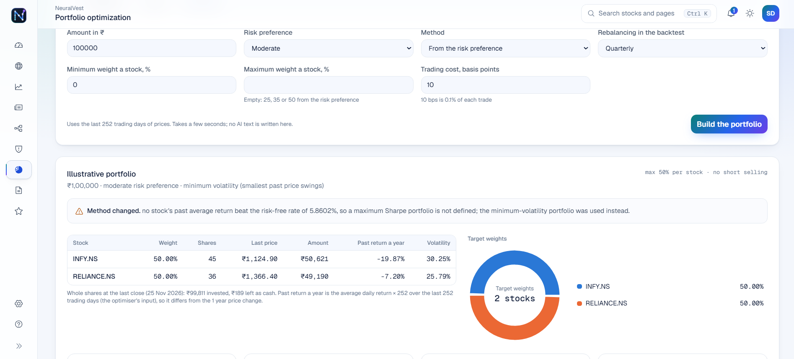 |
</details>

<details>
<summary><b>Reports</b>: saved reports, comparison and PDF</summary>

| Dark | Light |
|---|---|
| 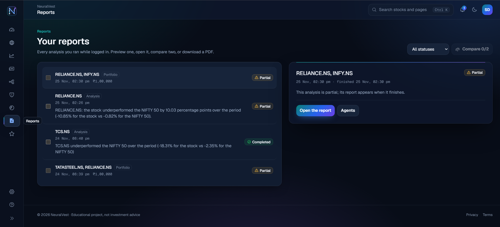 | 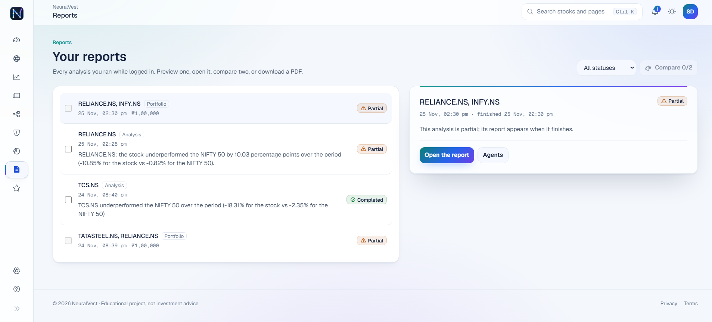 |
</details>

<details>
<summary><b>Settings</b>: theme, layout, profile picture and system status</summary>

| Dark | Light |
|---|---|
| 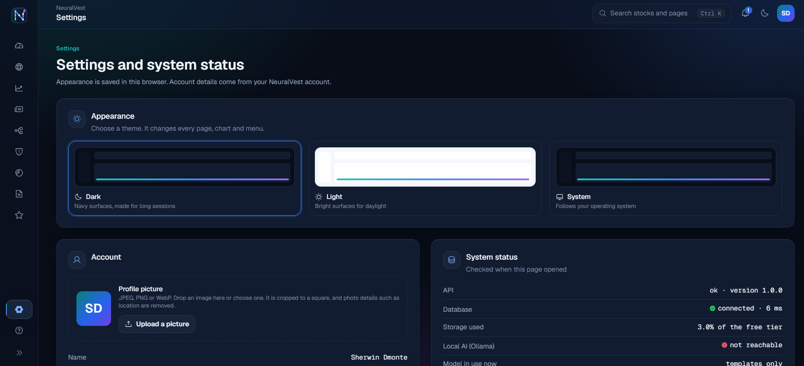 | 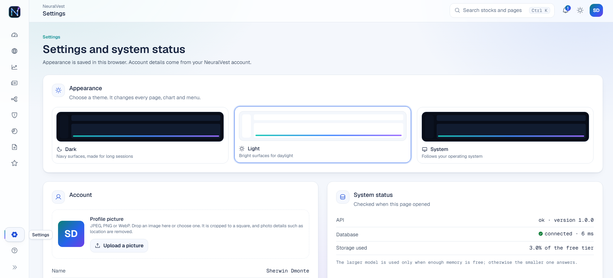 |
</details>

---

## How it works

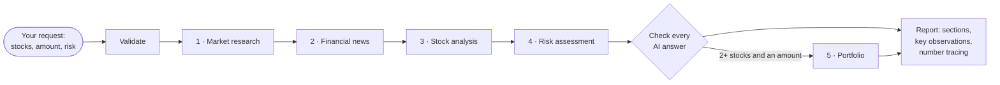

Each agent computes its figures first, then asks the model to explain them. An answer must pass every check:

1. valid JSON for its schema, with no extra fields;
2. every number in it appears in the computed facts (allowing for rounding);
3. it does not contradict a rule based reading, such as *above* or *below its 200-day average*;
4. a stated gap to the NIFTY 50 equals the computed difference;
5. in the key observations, each stock's sentences use only that stock's facts, and every stock is mentioned.

A failed answer is retried with the reason, then given to the smaller model, and finally replaced by a template. The
report records which model wrote each text. If Ollama is not running at all, the analysis still completes.

<details>
<summary><b>System architecture</b></summary>

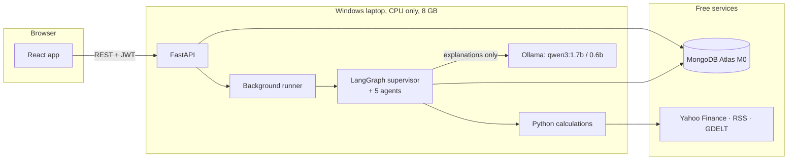

More diagrams (data flow, database schema, parallel mode): [docs/diagrams.md](docs/diagrams.md).
</details>

### Tech stack

| Layer | Tools |
|---|---|
| Agents | LangGraph 1.2 · Ollama · Qwen3 1.7B and 0.6B (thinking off, JSON schema output) |
| Analysis | pandas · NumPy · SciPy · PyPortfolioOpt · cvxpy · indicators implemented in the project |
| Data | yfinance (Yahoo Finance) · feedparser and BeautifulSoup (RSS) · GDELT (optional) · pypdf |
| Backend | Python 3.12 · FastAPI · Pydantic · PyMongo · ReportLab (PDF) · PyJWT and pwdlib (Argon2id) |
| Database | MongoDB Atlas free tier, 9 collections with `$jsonSchema` validators |
| Frontend | React 19 · Vite · Tailwind CSS 4 · Recharts · motion · React Router · Axios · Phosphor Icons · Geist |
| Testing | pytest (545 tests) · pytest-cov · oxlint |

---

## Getting started

**You need:** Windows 10 or 11, Python 3.12, Node.js 22 or newer, Git, Ollama and a free MongoDB Atlas cluster. The
[setup guide](docs/setup_guide.md) covers every step, including Atlas and the risk-free rate.

```powershell
git clone https://github.com/SherwinDmonte/NeuralVest.git NEURALVEST
cd NEURALVEST

# Local models
ollama pull qwen3:1.7b
ollama pull qwen3:0.6b

# Backend
cd backend
py -3.12 -m venv .venv
.\.venv\Scripts\Activate.ps1
pip install -r requirements.txt
Copy-Item .env.example .env        # then fill in MONGODB_URI, JWT_SECRET and the risk-free rate
uvicorn app.main:app --reload --port 8000

# Frontend (second terminal)
cd ..\frontend
npm install
Copy-Item .env.example .env
npm run dev                        # http://localhost:5173
```

<details>
<summary><b>Configuration</b>: the settings you fill in</summary>

| Setting (`backend/.env`) | Purpose |
|---|---|
| `MONGODB_URI` | Your Atlas connection string, with the real password (never committed) |
| `JWT_SECRET` | At least 32 random characters: `python -c "import secrets; print(secrets.token_urlsafe(48))"` |
| `RISK_FREE_RATE_PCT`, `_DATE`, `_SOURCE` | RBI 91-day Treasury bill yield, with its date and source, for Sharpe ratios |
| `LLM_MIN_FREE_RAM_MB` | Free RAM needed to use the 1.7B model (default 3000); otherwise the 0.6B model answers |
| `AGENT_EXECUTION_MODE` | `sequential` (default, lowest memory) or `parallel` |

All settings: [`backend/.env.example`](backend/.env.example) and the [setup guide](docs/setup_guide.md#7-configuration).
</details>

<details>
<summary><b>Using it</b></summary>

1. Open http://localhost:5173 and choose **Create a free account**.
2. In **Stock analysis**, enter one or more symbols: `RELIANCE`, `TCS`, or BSE codes such as `500325`.
3. For two or more stocks, add an amount and a risk preference to get an illustrative portfolio.
4. Follow the agents in **AI agents** while it runs: about a minute for one stock, four minutes for five stocks with
   a portfolio, on an 8 GB laptop.
5. Read the report, compare reports, or download a PDF from **Reports**.

From the terminal instead: `python scripts/run_analysis.py RELIANCE TCS --amount 100000 --no-gdelt` (in `backend`).
</details>

---

## API

FastAPI serves 33 operations under `/api`, with interactive documentation at http://localhost:8000/docs.

| Group | Endpoints |
|---|---|
| Auth | register, login, profile, watchlist, profile picture |
| Analysis | start, status, results, report, rerun |
| Stocks and market | search, price history, indicators, statements, indices, breadth, quotes |
| News, risk, portfolio | stored news and sentiment, risk analysis, optimisation, backtest |
| Reports | list, view, PDF |
| Health | API, database and local model status |

Every error has the same JSON shape with a stable `code` and a request id. Full reference:
[docs/api_documentation.md](docs/api_documentation.md) · schema: [docs/openapi.json](docs/openapi.json).

---

## Testing and performance

| | |
|---|---|
| **Automated tests** | 545 passing, 94% statement coverage: calculations, data sources, each agent alone (including the LLM failing mid-run), the workflow, the API, authentication, the database and a frontend contract test |
| **Financial validation** | Every metric recomputed by independent reference code on two years of real NSE prices and three companies' statements: 42 of 42 agree to the displayed precision |
| **One stock** | 59 s on the development laptop |
| **Five stocks + portfolio** | 249 s |
| **Memory** | Backend 0.2 GB · Ollama 0.9 GB (0.6B) or 1.5 to 1.7 GB (1.7B) · browser 0.5 GB |
| **Database** | 4 to 22 ms median per query (Atlas free tier) |

```powershell
cd backend
python -m pytest
```

Method, all measurements and the problems found and fixed: [docs/testing_report.md](docs/testing_report.md).

---

## Project structure

<details>
<summary>Show the folders</summary>

```text
NEURALVEST/
├── backend/
│   ├── app/
│   │   ├── agents/          the five agents
│   │   ├── analysis/        indicators, fundamentals, risk, optimisation, backtest
│   │   ├── api/             routes, errors, rate limits, authentication dependencies
│   │   ├── data/            prices, statements, news, symbols, validation, cache
│   │   ├── database/        models, validators, indexes, repository
│   │   ├── llm/             Ollama client, prompts, output guards
│   │   ├── orchestration/   LangGraph graph and supervisor
│   │   ├── services/        background runner, report, PDF, auth, profile pictures
│   │   └── main.py          FastAPI app
│   ├── scripts/             run, measure, validate, export and maintenance scripts
│   └── tests/               545 tests
├── frontend/
│   └── src/
│       ├── pages/           the app's pages
│       ├── landing/         the public landing page
│       ├── components/      shared UI and charts
│       └── services/api.js  every API call
└── docs/                    architecture, setup, API, diagrams, testing, report, presentation
```
</details>

---

## Documentation

| Document | Contents |
|---|---|
| [Setup guide](docs/setup_guide.md) | Windows installation, configuration, running, troubleshooting |
| [Architecture](docs/architecture.md) | Design, agent contracts, memory strategy, data limitations, licensing |
| [Diagrams](docs/diagrams.md) | System, agent workflow, data flow and database schema |
| [Database design](docs/database_design.md) | Collections, validators, indexes and storage estimates |
| [API documentation](docs/api_documentation.md) | Endpoints, authentication, errors and rate limits |
| [Testing report](docs/testing_report.md) | Tests, financial validation, performance and memory |
| [Project report](docs/project_report.md) | The final academic report |
| [Presentation outline](docs/presentation_outline.md) | Slides, demo script and likely questions |

---

## Limitations

* Yahoo Finance is reached through the unofficial yfinance library: data can be delayed, revised or missing.
* Annual statements lag the latest quarter; news coverage from RSS feeds is partial.
* Small local models write plain text, and judge news sentiment less reliably than large ones.
* Backtests use stocks chosen today (hindsight) and one current risk-free rate.
* No hosted version: it runs on your own machine.

## License

[MIT](LICENSE) © 2026 Sherwin Dmonte. Third-party packages keep their own licenses (MIT, BSD, Apache 2.0 and, for
the Geist fonts, OFL-1.1); the Qwen3 models are Apache 2.0 and are downloaded by Ollama. Market data belongs to its
providers and is not redistributed in this repository.
