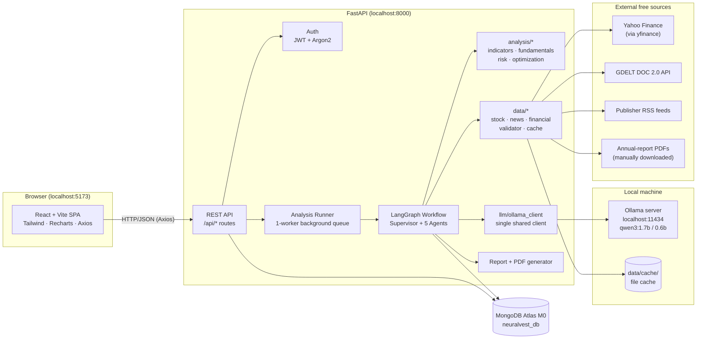
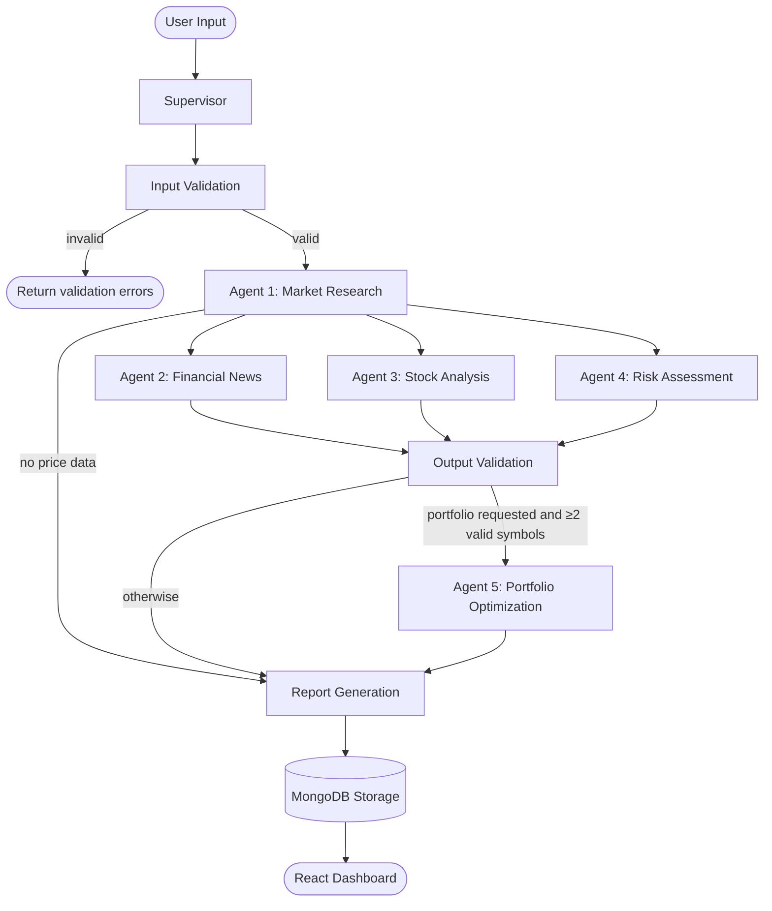

# NeuralVest — System Architecture

> **Status:** Phase 0 design document (no implementation yet). **Revision 2**: review corrections applied (memory target, job recovery, source of truth, D1–D4 resolved).
> **Last updated:** 2026-11-23
> **Companion documents:** [database_design.md](database_design.md) · [setup_guide.md](setup_guide.md)

NeuralVest is an educational, multi-agent financial intelligence platform for Indian equities (NSE/BSE). It runs entirely on a Windows laptop with 8 GB RAM, a CPU and no paid services.

All outputs are **educational and illustrative**. They are not investment advice and not real-time market data (see [§11](#11-free-tier--data-source-limitations)).

---

## Contents

1. [Concepts Primer](#1-concepts-primer-for-this-project)
2. [System Architecture](#2-system-architecture)
3. [Multi-Agent Workflow Architecture](#3-multi-agent-workflow-architecture)
4. [Shared Workflow State](#4-shared-workflow-state)
5. [Agent Contracts (Input/Output)](#5-agent-contracts-inputoutput)
6. [Python vs. LLM Responsibilities](#6-python-vs-llm-responsibilities)
7. [Background Execution Model](#7-background-execution-model)
8. [Technology Stack Justification](#8-technology-stack-justification)
9. [Final Folder Structure](#9-final-folder-structure)
10. [Hardware & Memory Optimization Strategy](#10-hardware--memory-optimization-strategy)
11. [Free-Tier & Data-Source Limitations](#11-free-tier--data-source-limitations)
12. [Licensing Notes](#12-licensing-notes)
13. [Development Roadmap](#13-development-roadmap)
14. [Data Limitations & Disclaimers](#14-data-limitations--disclaimers)
15. [Open Decisions](#15-open-decisions)
16. [Sources](#16-sources)

---

## 1. Concepts Primer (for this project)

| Concept | Plain-language meaning | Where it appears in NeuralVest |
|---|---|---|
| **LLM** (Large Language Model) | A neural network trained to predict text. It is good at summarizing and explaining, and **bad at arithmetic and facts it was not given**. | Qwen3 1.7B runs locally through Ollama. It writes news summaries and explanations. |
| **AI agent** | A program with one goal, its own tools (functions, data sources), and a decision procedure. It reads inputs, uses tools and produces a structured result. | Five agents, each with one financial responsibility. |
| **Multi-agent system** | Several specialized agents that each solve part of a problem and pass results to one another. | Market → News → Fundamentals → Risk → Portfolio. |
| **Orchestration** | The "manager" logic that decides which agent runs, in what order, what happens on failure, and how results are combined. | The LangGraph supervisor. |
| **LangGraph** | A library where a workflow is a **graph**: *nodes* are functions (agents) and *edges* define what runs next. Edges can be conditional, for example "skip Portfolio if only 1 stock". | `orchestration/graph.py` |
| **Shared state** | One dictionary that travels through the graph. Each agent reads what it needs and writes its own section. | `orchestration/state.py` (§4) |
| **Tool calling** | Letting an LLM request that a function be executed. **NeuralVest deliberately avoids LLM-driven tool calling.** Python code decides which tools run, because small models choose tools unreliably. | Agents call tools directly in Python. |
| **Prompt engineering** | Designing the instructions and context given to the LLM so its output is accurate and well-formatted (for example JSON). | `llm/prompts.py` |
| **RAG** (Retrieval-Augmented Generation) | Fetching relevant documents and placing them in the prompt so the LLM answers from them. | Light form: news articles and computed metrics are injected into prompts. A vector database is **not** used initially (8 GB RAM constraint). |
| **Technical indicators** | Formulas on price and volume history (SMA, RSI, MACD…) that describe trend and momentum. | `analysis/technical_indicators.py` |
| **Portfolio optimization** | Choosing weights across stocks to balance expected return against risk, using historical estimates. | `analysis/optimization.py` |

---

## 2. System Architecture



### 2.1 Layer responsibilities

| Layer | Responsibility | Does **not** do |
|---|---|---|
| **React frontend** | Collects input, starts analyses, polls status, renders charts and reports | Any financial calculation |
| **FastAPI API layer** (`api/routes`) | Validates requests (Pydantic), authenticates, returns stored results, queues analysis jobs | Long-running work inside the request |
| **Analysis runner** (`services/`) | Runs one LangGraph workflow at a time in the background and records progress | Business logic |
| **Orchestration** (`orchestration/`) | Routing, ordering, retries, validation, state management | Calculations or data fetching itself |
| **Agents** (`agents/`) | One responsibility each; combine data + analysis + LLM explanation | Talking to the HTTP layer |
| **Analysis** (`analysis/`) | Pure, deterministic, unit-tested math (pandas/NumPy/SciPy/PyPortfolioOpt) | I/O or LLM calls |
| **Data** (`data/`) | Fetching, caching, cleaning, validation, provenance | Interpretation |
| **LLM** (`llm/`) | One shared Ollama client, prompts, JSON validation, fallbacks | Producing numbers |
| **Database** (`database/`) | Connection, document models, indexes, repositories | Business logic |

### 2.2 Request lifecycle (single-stock analysis)

1. The user enters `RELIANCE` on the Stock Analysis page → `POST /api/analysis/start`.
2. FastAPI validates the input, creates `request_id`, writes an `analysis_reports` job record (`status: "queued"`, full `request_params`, first `status_history` entry), puts the job in the runner queue and **returns immediately** (HTTP 202).
3. The runner executes the LangGraph workflow. Each agent updates `agent_status` and writes its output to `agent_results`, which is the **authoritative** store of agent outputs ([database_design.md §2.1](database_design.md#21-which-collection-is-authoritative)).
4. The frontend polls `GET /api/analysis/{request_id}/status` every 2–3 s and updates the Agent Monitoring view.
5. When the workflow finishes, Report Generation writes the narrative and the write-once projections (`risk_reports`, `portfolios`, headline summaries with references in `analysis_reports`). The status becomes `completed`, `partial` or `failed`. The frontend loads `GET /api/analysis/{request_id}/report`.

---

## 3. Multi-Agent Workflow Architecture

### 3.1 Target graph (from the project specification)



### 3.2 Default execution mode: sequential

On 8 GB RAM, **sequential execution is the default**. The three middle agents run one after another:

```
Input Validation → Market Research → Financial News → Stock Analysis → Risk Assessment
→ Output Validation → [Portfolio Optimization] → Report Generation → Persist
```

A config flag `AGENT_EXECUTION_MODE=parallel` enables LangGraph fan-out for News / Stock Analysis / Risk in Phase 10. Only the News Agent calls the LLM heavily, and the LLM client is serialized (§10), so parallel mode only overlaps network I/O. It never runs two inferences at once.

### 3.3 Node responsibilities and dependencies

| Node | Reads from state | Writes to state | Depends on |
|---|---|---|---|
| Supervisor / Input Validation | `stock_symbols`, `investment_amount`, `risk_preference` | normalized symbols, `errors`, `agent_status` | — |
| Market Research | symbols | `market_data`, `market_analysis` | Validation |
| Financial News | symbols, company names | `news_data`, `news_analysis` | Market Research (company name, valid symbols) |
| Stock Analysis | symbols, latest price | `financial_data`, `stock_analysis` | Market Research (price for P/E, P/B) |
| Risk Assessment | `market_data` (prices + benchmark) | `risk_analysis` | Market Research (**re-uses prices; nothing is fetched again**) |
| Output Validation | all agent outputs | `errors`, validated flags | News, Stock Analysis, Risk |
| Portfolio Optimization | `market_data`, `risk_analysis`, amount, preference | `portfolio_analysis` | Output Validation |
| Report Generation | everything | `final_report` | All of the above |

### 3.4 Failure paths

| Failure | Handling |
|---|---|
| Invalid symbol / no price data | That symbol is dropped with an error entry. If **no** symbol is valid → straight to the report with `status: "failed"`. |
| Network error (Yahoo, GDELT, RSS) | Retried up to 2× with exponential backoff, then the agent is marked `failed`. Other agents still run if they do not depend on it. |
| LLM timeout / invalid JSON | Retry → fallback model `qwen3:0.6b` → deterministic template text. Numbers are unaffected because they come from Python. |
| Missing fundamentals | Field set to `null` with a `reason`. The agent completes with `status: "partial"`. |
| Portfolio infeasible (constraints) | Falls back to equal weight with an explicit warning, or reports infeasibility. |
| Any agent fails | The report is still generated. Missing sections are marked "unavailable" and listed under *Data limitations*. |
| Server stopped mid-run | The request becomes `interrupted` at the next startup. Completed agent results are kept and the user can re-run (§7). |

Agent status values: `pending → running → completed | partial | failed | skipped | interrupted`.

### 3.5 Build-up across phases

| Phase | Graph contents |
|---|---|
| 5 | Input Validation → Market Research → Financial News → Report stub |
| 7 | + Stock Analysis |
| 8 | + Risk Assessment |
| 9 | + Output Validation → Portfolio Optimization |
| 10 | Full supervisor: routing, retries, conditional edges, optional parallel mode, final report |

---

## 4. Shared Workflow State

Defined in `backend/app/orchestration/state.py` as a `TypedDict`. Fields that several nodes may update use **reducers**, so parallel mode merges results safely instead of overwriting them.

```python
# Design sketch (implementation in Phase 5, finalized in Phase 10)
from typing import TypedDict, Annotated, Literal, Any
import operator

AgentName = Literal["market_research", "financial_news", "stock_analysis",
                    "risk_assessment", "portfolio_optimization"]

def merge_dicts(a: dict, b: dict) -> dict:
    return {**a, **b}

class NeuralVestState(TypedDict, total=False):
    # --- request ---
    request_id: str                      # uuid4 hex
    user_id: str | None                  # None until auth (Phase 11)
    stock_symbols: list[str]             # normalized, e.g. ["RELIANCE.NS"]
    investment_amount: float | None      # INR, required only for portfolio
    risk_preference: Literal["conservative", "moderate", "aggressive"]
    request_type: Literal["single_stock", "portfolio"]

    # --- agent outputs (each written by exactly one agent) ---
    market_data: dict[str, Any]          # per symbol: OHLCV records + validation report
    market_analysis: dict[str, Any]      # per symbol: indicators, trend, benchmark
    news_data: dict[str, list]           # per symbol: normalized articles
    news_analysis: dict[str, Any]        # per symbol: sentiment, summaries, digest
    financial_data: dict[str, Any]       # per symbol: raw statement items + periods
    stock_analysis: dict[str, Any]       # per symbol: ratios, assessments
    risk_analysis: dict[str, Any]        # per symbol + portfolio-level metrics
    portfolio_analysis: dict[str, Any]   # weights, amounts, backtest

    # --- bookkeeping (reducers allow concurrent updates) ---
    agent_status: Annotated[dict[str, str], merge_dicts]
    errors: Annotated[list[dict], operator.add]          # {agent, symbol, code, message, recoverable}
    data_sources: Annotated[list[dict], operator.add]    # {source, url, fetched_at, data_as_of}
    timestamps: Annotated[dict[str, dict], merge_dicts]  # {agent: {started_at, finished_at, duration_s}}

    final_report: dict[str, Any]
```

**Design rules**

- Large raw data (for example 1 year of OHLCV for 10 stocks) is kept compact in state, as a list of records or a column dict. pandas DataFrames are never stored in state, because state must stay JSON-serializable for checkpointing and MongoDB.
- Agents never modify another agent's section.
- Every numeric value written to state comes from Python code.

---

## 5. Agent Contracts (Input/Output)

Each agent is a function `run(state) -> partial_state_update` with Pydantic schemas in `backend/app/schemas/agents.py`. Below are the **output contracts** (trimmed). Every agent output also carries the common envelope:

```json
{
  "agent": "market_research",
  "status": "completed | partial | failed | skipped",
  "generated_at": "2026-11-23T10:00:00+05:30",
  "data_sources": [{"source": "Yahoo Finance via yfinance", "data_as_of": "2026-11-21", "fetched_at": "..."}],
  "warnings": ["..."],
  "llm": {"model": "qwen3:1.7b", "used_fallback": false}
}
```

### 5.1 Agent 1 — Market Research

**Input:** `symbols: list[str]`, `period: str = "1y"`, `benchmark: str = "^NSEI"`

```json
{
  "symbol": "RELIANCE.NS",
  "company_name": "Reliance Industries Limited",
  "last_close": 1234.5, "last_close_date": "2026-11-21",
  "period_return_pct": 8.4,
  "indicators": {
    "sma_20": 1220.1, "sma_50": 1201.7, "sma_200": 1150.3,
    "ema_12": 1225.0, "ema_26": 1215.2,
    "rsi_14": 56.2,
    "macd": {"macd": 9.8, "signal": 7.1, "histogram": 2.7},
    "bollinger": {"upper": 1260.0, "middle": 1220.1, "lower": 1180.2}
  },
  "volume": {"avg_20d": 8900000, "last": 10400000, "spike_ratio": 1.17},
  "trend": {"classification": "bullish | bearish | sideways", "rules_triggered": ["close > sma_50 > sma_200"]},
  "benchmark_comparison": {"benchmark": "^NSEI", "stock_return_pct": 8.4, "benchmark_return_pct": 6.1, "relative_pct": 2.3},
  "price_series": [{"date": "2025-11-24", "close": 1100.2, "sma_20": null}],
  "validation": {"rows": 248, "missing_filled": 0, "duplicates_removed": 0, "outliers_flagged": 1, "is_stale": false},
  "explanation": "LLM text that references only the values above"
}
```

*(The numbers above are illustrative placeholders that show the shape, not real data.)*

### 5.2 Agent 2 — Financial News

**Input:** `symbol`, `company_name`, `lookback_days: int = 14`, `max_articles: int = 8`

```json
{
  "symbol": "RELIANCE.NS",
  "articles": [{
    "headline": "...", "publisher": "...", "url": "https://...",
    "published_at": "2026-11-20T08:15:00Z", "source": "gdelt | rss",
    "category": "quarterly_results | m_and_a | government_policy | regulatory | economic | industry | governance | legal | company_announcement | other",
    "sentiment": "positive | negative | neutral | uncertain",
    "summary": "1–2 sentences (LLM)",
    "relevance": "high | medium | low"
  }],
  "sentiment_breakdown": {"positive": 3, "negative": 1, "neutral": 3, "uncertain": 1},
  "digest": "Short overall summary (LLM)",
  "disclaimer": "News sentiment is not a prediction of future returns."
}
```

### 5.3 Agent 3 — Stock Analysis

**Input:** `symbol`, `last_close` (from Agent 1)

```json
{
  "symbol": "RELIANCE.NS",
  "statement_period": {"annual_latest": "2026-03-31", "source": "Yahoo Finance via yfinance"},
  "metrics": {
    "revenue_growth_yoy_pct": {"value": 7.2, "period": "FY2026 vs FY2025"},
    "net_profit_growth_yoy_pct": {"value": null, "reason": "net income missing for FY2025"},
    "eps": {"value": 51.2}, "pe": {"value": 24.1}, "pb": {"value": 2.3},
    "roe_pct": {"value": 9.5}, "roa_pct": {"value": 4.6},
    "debt_to_equity": {"value": 0.41}, "current_ratio": {"value": 1.15},
    "operating_margin_pct": {"value": 16.8}, "net_margin_pct": {"value": 8.0}
  },
  "assessments": {"profitability": "moderate", "liquidity": "adequate", "leverage": "low", "growth": "moderate"},
  "strengths": ["..."], "weaknesses": ["..."],
  "explanation": "LLM text"
}
```

Rule: a metric that cannot be computed is `{"value": null, "reason": "..."}`. It is never guessed. P/E with negative EPS → `null` with the reason "negative earnings".

### 5.4 Agent 4 — Risk Assessment

**Input:** price series for the symbols plus the benchmark (from state), `weights` (optional)

```json
{
  "per_symbol": {"RELIANCE.NS": {
    "annualized_volatility_pct": 22.4, "beta": 1.05,
    "max_drawdown_pct": -18.3, "max_drawdown_period": ["2026-02-01", "2026-04-15"],
    "sharpe_ratio": 0.41, "return_distribution": {"mean_daily_pct": 0.04, "std_daily_pct": 1.4, "skew": -0.2, "kurtosis": 3.1, "p5_pct": -2.1, "p95_pct": 2.2},
    "risk_classification": "low | moderate | high"
  }},
  "portfolio": {"correlation_matrix": {"RELIANCE.NS": {"TCS.NS": 0.32}}, "concentration_hhi": 0.25, "diversification": "moderate"},
  "assumptions": {"risk_free_rate": {"value_pct": 6.5, "as_of_date": "2026-11-20", "source": "RBI 91-day T-bill yield (entered manually)"}, "trading_days": 252},
  "warnings": ["..."],
  "disclaimer": "Historical risk measurements are not forecasts."
}
```

*(Values are illustrative placeholders.)* The risk-free rate comes from `.env` (`RISK_FREE_RATE_PCT`, `RISK_FREE_RATE_DATE`, `RISK_FREE_RATE_SOURCE`). The exact value, date and source used are **recorded in every risk report and portfolio result**, so any historical Sharpe ratio can be reproduced (decision D4). The agent refuses to compute Sharpe ratios if any of the three settings is missing, and reports that reason instead.

### 5.5 Agent 5 — Portfolio Optimization

**Input:** `symbols (≥2)`, `investment_amount`, `risk_preference`, `method`, `constraints {max_weight, min_weight, allow_short=false}`

```json
{
  "method": "max_sharpe | min_volatility | efficient_risk | equal_weight | inverse_volatility | hrp",
  "assumptions": {"expected_returns": "mean historical daily returns, annualized (252)", "covariance": "Ledoit-Wolf shrinkage", "lookback": "2y", "transaction_cost_bps": 10, "rebalancing": "quarterly"},
  "allocations": [{"symbol": "TCS.NS", "weight_pct": 30.0, "amount_inr": 30000, "shares": 7, "last_price": 4000.0}],
  "leftover_cash_inr": 1250,
  "expected_metrics": {"annual_return_pct": 12.1, "annual_volatility_pct": 15.3, "sharpe_ratio": 0.37},
  "backtest": {"cagr_pct": 10.4, "volatility_pct": 16.0, "max_drawdown_pct": -14.2, "sharpe": 0.30, "vs_benchmark": {"nifty50_cagr_pct": 9.1, "equal_weight_cagr_pct": 9.8}, "equity_curve": [{"date": "...", "value": 100000}]},
  "disclaimer": "Illustrative allocation based on historical data. Not personalized investment advice; no profit is guaranteed."
}
```

**Risk preference → default method:** conservative → `min_volatility`, max weight 25%; moderate → `max_sharpe`, max weight 35%; aggressive → `efficient_risk` at a higher target volatility, max weight 50%. The user can override the method explicitly.

---

## 6. Python vs. LLM Responsibilities

**The central rule: the LLM never produces a number that is shown to the user as data.**

| Python (deterministic, tested) | LLM (Qwen3 via Ollama) |
|---|---|
| Fetching, cleaning and validating data | Summarizing news articles (1–2 sentences) |
| All indicators, ratios and risk metrics | Classifying news sentiment and category (validated against an allowed list) |
| Trend classification (rule-based) | Plain-language explanation of **already computed** metrics |
| Risk classification (rule-based thresholds) | Report narrative ("key observations") |
| Portfolio optimization and backtesting | |
| Report assembly (tables, numbers, sources) | |

**Enforcement**

1. Prompts receive computed values as a JSON block and are told to use only those values.
2. LLM output is parsed into a Pydantic model. Free-text fields are scanned for numbers, and any number not in the input JSON (with rounding tolerance) causes the text to be replaced by a deterministic template.
3. Report tables are rendered from the Python values, never from LLM text.
4. Retrieved text (news) is wrapped in clearly marked `<article>` data blocks. The system prompt says instructions inside the data must be ignored (prompt-injection defense).

---

## 7. Background Execution Model

- **Mechanism:** a single `concurrent.futures.ThreadPoolExecutor(max_workers=1)` owned by `services/analysis_runner.py`. Jobs queue up and only **one workflow runs at a time** to protect RAM. No Celery, Redis or extra processes.
- **Why not `BackgroundTasks`?** FastAPI's `BackgroundTasks` has no concurrency limit and no queue. A bounded single worker is safer on 8 GB.
- **Status tracking:** the runner updates `analysis_reports.status` (and appends to `status_history`) and the per-agent `agent_results` documents in MongoDB, plus an in-memory dictionary for fast polling. Polling therefore works even after a page reload.
- **Restart behavior** (full detail in [database_design.md §6](database_design.md#6-job-status-lifecycle-and-recovery)):
  - Jobs still `queued` (never started) are **re-queued automatically** from their stored `request_params`, with a history entry.
  - Jobs that were `running` become **`interrupted`** (a distinct status, not `failed`). Agent results that completed are kept, and the user sees an "Interrupted" badge with a **Re-run** button. A re-run creates a new request that links to the old one (`retry_of`). Workflows are not resumed half-way.
  - No status information is deleted. Every change is recorded in `status_history`.
- **Optional checkpointing:** LangGraph's SQLite checkpointer can be enabled in Phase 10 (file `data/cache/checkpoints.sqlite`). It is used only for workflow checkpoints, never as the application database.
- **Timeouts:** per external HTTP call 15–30 s, per LLM call 90 s (CPU), whole workflow 15 min.

---

## 8. Technology Stack Justification

### 8.1 Target versions

Exact versions are pinned in `requirements.txt` / `package.json` during Phase 1 after a successful install. The targets below come from the research in §16.

| Component | Target | Reason |
|---|---|---|
| **Python** | **3.12.x** (64-bit) | cvxpy (required by PyPortfolioOpt) needs ≥3.11. LangGraph needs ≥3.10. 3.12 has the widest availability of Windows binary wheels across the scientific stack. 3.13/3.14 would work for most packages but carry more risk of missing wheels. |
| **Node.js** | **26.x LTS** (Active LTS since Oct 2026) | Current Active LTS. 24.x (Maintenance LTS) is also acceptable. |
| LangGraph | 1.x (latest 1.2.x) | Stable 1.0+ API with LTS policy |
| FastAPI / Uvicorn / Pydantic | latest / latest / 2.x | Pydantic v2 is required by LangGraph |
| PyMongo | 4.x | Official driver; synchronous is enough with one worker |
| yfinance | 1.x (1.8.0 installed in Phase 1) | Changes often because Yahoo changes. Always pinned, upgraded when it breaks |
| pandas | 3.x (3.1.1 installed in Phase 1) | Copy-on-Write is the default in pandas 3; code avoids chained assignment |
| PyPortfolioOpt | 1.6.x (with cvxpy 1.9.x) | Mature optimizer library |

### 8.2 Component justification

| Area | Choice | Why it fits 8 GB RAM and zero budget | Alternatives rejected |
|---|---|---|---|
| Frontend | React + Vite (JS) | Fast dev server, small builds, huge ecosystem | Next.js (SSR is not needed; heavier) |
| Styling | Tailwind CSS (v4, `@tailwindcss/vite` plugin) | Utility classes give a consistent design without a component-library payload | Material UI (heavy) |
| Charts | Recharts | Declarative React charts; covers line, area, bar, pie | Chart.js (imperative), D3 (too low-level for timeline) |
| HTTP / routing / icons | Axios, React Router, Lucide React | Small, standard | — |
| API | FastAPI + Uvicorn + Pydantic | Async-capable, automatic Swagger docs, schema validation built in | Flask (no built-in validation/docs), Django (heavy) |
| Orchestration | LangGraph | Explicit graph + typed state + conditional edges + checkpointing, which is exactly the supervisor pattern required | CrewAI / AutoGen (more LLM-driven autonomy, unreliable with a 1.7B model) |
| LangChain | **Minimal / likely none**. Only `langchain-core` arrives as a LangGraph dependency. | A direct Ollama REST client is simpler and lighter, and gives full control over timeouts and fallback | `langchain-ollama` wrapper (could be added later if useful) |
| LLM runtime | Ollama | Free, CPU inference, simple REST API, manages model loading/unloading | llama.cpp directly (more manual), LM Studio (GUI-oriented) |
| LLM model | `qwen3:1.7b` (fallback `qwen3:0.6b`) | Roughly 1.3 GB weights at Q4. Apache 2.0. Thinking mode can be switched off. | 7B+ models (too much RAM) |
| Market data | yfinance | Free; covers NSE (`.NS`), BSE (`.BO`) and NIFTY 50 (`^NSEI`) | Paid APIs excluded; NSE scraping prohibited (§11) |
| News | GDELT DOC API + feedparser (RSS) | Free, no API key | NewsAPI (key + commercial limits) |
| Indicators | **Custom pandas/NumPy implementations** | Original `pandas-ta` appears unmaintained and had NumPy 2 problems. Our own ~150 lines are transparent, unit-tested against reference values, and teach the formulas. | pandas-ta (risk), forks (uncertain support), TA-Lib (C dependency, harder on Windows) |
| Statistics | NumPy, SciPy, pandas | Standard | — |
| Optimization | PyPortfolioOpt (+ cvxpy) | Mean-variance, min-vol, max-Sharpe, HRP, Ledoit-Wolf, discrete allocation built in | Writing optimizers by hand |
| Database | MongoDB Atlas M0 + PyMongo | Free cluster; document model fits nested agent outputs | SQLite as the main DB (excluded by the specification) |
| Passwords | `pwdlib[argon2]` | Maintained successor to passlib (passlib is unmaintained and reported to break on Python 3.13+). Argon2 is the modern default. | passlib |
| Tokens | PyJWT | Small, maintained | python-jose (less active) |
| Rate limiting | slowapi | In-memory limiter for FastAPI, no Redis needed | — |
| PDF export | ReportLab (BSD license) | Generates PDFs from Python; no browser engine needed | WeasyPrint (GTK dependencies on Windows) |
| PDF reading | **pypdf** (BSD-3) (decision D1) | Pure Python, light, permissive license; enough for text extraction from annual reports | PyMuPDF (AGPL-3.0 would constrain the repository license) |
| Config | pydantic-settings / python-dotenv | Typed environment config | — |
| Testing | pytest, FastAPI TestClient | Standard | — |

---

## 9. Final Folder Structure

Based on Section 15 of the specification. Deviations are listed below the tree.

```
NEURALVEST/                         # repository root
├── frontend/
│   ├── public/
│   ├── src/
│   │   ├── components/             # Card, StatTile, Badge, charts/*, layout pieces
│   │   ├── pages/                  # Landing, Dashboard, StockAnalysis, AgentMonitor,
│   │   │                           # News, Portfolio, Risk, Reports, Login, Register
│   │   ├── layouts/                # AppLayout (sidebar + topbar), PublicLayout
│   │   ├── services/               # api.js (Axios instance), per-domain API modules
│   │   ├── hooks/                  # useAnalysisPolling, useAuth, ...
│   │   ├── assets/
│   │   ├── App.jsx
│   │   └── main.jsx
│   ├── .env.example
│   └── package.json
│
├── backend/
│   ├── app/
│   │   ├── main.py
│   │   ├── config.py
│   │   ├── agents/
│   │   │   ├── market_research.py
│   │   │   ├── financial_news.py
│   │   │   ├── stock_analysis.py
│   │   │   ├── risk_assessment.py
│   │   │   └── portfolio_optimizer.py
│   │   ├── orchestration/
│   │   │   ├── graph.py
│   │   │   ├── state.py
│   │   │   └── supervisor.py
│   │   ├── llm/
│   │   │   ├── ollama_client.py
│   │   │   └── prompts.py
│   │   ├── data/
│   │   │   ├── stock_data.py
│   │   │   ├── news_data.py
│   │   │   ├── financial_data.py
│   │   │   └── data_validator.py
│   │   ├── analysis/
│   │   │   ├── technical_indicators.py
│   │   │   ├── fundamentals.py
│   │   │   ├── risk_metrics.py
│   │   │   ├── optimization.py
│   │   │   └── backtesting.py          # ← deviation 1
│   │   ├── database/
│   │   │   ├── database.py
│   │   │   └── models.py
│   │   ├── api/
│   │   │   └── routes/
│   │   │       ├── auth.py  stocks.py  analysis.py  news.py
│   │   │       └── risk.py  portfolio.py  reports.py
│   │   ├── schemas/                    # API + agent Pydantic schemas
│   │   ├── services/                   # analysis_runner.py, report_generator.py, pdf_export.py, auth_service.py
│   │   └── utils/                      # logging, request id, timing, symbols
│   ├── tests/
│   │   └── fixtures/                   # ← deviation 2
│   ├── requirements.txt
│   └── .env.example
│
├── data/
│   ├── cache/                          # git-ignored
│   ├── historical/                     # git-ignored (except README)
│   ├── financial_reports/              # manually downloaded PDFs (git-ignored)
│   └── exports/                        # generated PDFs (git-ignored)
│
├── docs/
│   ├── architecture.md
│   ├── database_design.md
│   ├── api_documentation.md            # Phase 14
│   └── setup_guide.md
│
├── tasks.md                            # ← deviation 3
├── README.md
└── .gitignore
```

**Deviations (each with a reason)**

1. `analysis/backtesting.py`: backtesting is a separate responsibility from optimization (simulating over time vs. solving for weights). Keeping it separate keeps both files testable and small.
2. `backend/tests/fixtures/`: saved historical datasets make the financial tests reproducible without network access (Section 14 requirement).
3. `tasks.md` at the root: the progress tracker you asked for.

4. *(Phase 2)* `api/errors.py` (centralized exception handlers + `AppError`) and `api/routes/health.py` (`/api/health`, `/api/health/db`): health checks and error handling are API concerns, but not one of the spec's domain route files.
5. *(Phase 2)* `database/` is split into `database.py` (connection, startup, storage guard), `models.py`, `schema_validators.py`, `indexes.py`, `repository.py`, `integrity.py` and `retention.py`. Each has one responsibility; one big `database.py` would mix connection handling, validation rules and maintenance.
6. *(Phase 2)* `backend/scripts/` holds maintenance scripts (`check_integrity.py`, `cleanup_market_data.py`, `measure_llm_memory.ps1`) that reuse the same repository code (database_design.md §5.2).

7. *(Phase 3)* `app/data/` adds `symbols.py` (normalization + curated list), `cache.py` (file cache), `errors.py`, `pdf_text.py` (pypdf extraction) and `seed_symbols.json` beside the four spec files. Each is a separate, testable concern.
8. *(Phase 3)* Test fixtures are **synthetic** (`tests/fixtures/`, generated by a committed script). Real Yahoo data is not committed, because its terms restrict redistribution. Real-data verification uses `scripts/fetch_sample_data.py`, whose output stays in the git-ignored cache and in MongoDB.

No other deviations. Helper modules such as `services/analysis_runner.py` sit inside folders the specification already defines.

---

## 10. Hardware & Memory Optimization Strategy

### 10.1 Memory target

"8 GB RAM" does not mean 8 GB is available. Windows reserves some, and the system becomes unusable when memory is fully committed and starts paging heavily. NeuralVest therefore sets an explicit target:

| Rule | Value |
|---|---|
| **Peak total RAM in use during a full analysis** (Task Manager → Performance → Memory → "In use") | **≤ 6.5 GB** |
| **Free headroom kept** for Windows, file cache and spikes | **≥ 1.5 GB** |
| **NeuralVest's own processes** (backend + Ollama with model + Vite + one browser tab) | **≤ 3.5 GB** |

### 10.2 Estimated budget per process

These are **estimates** from public sources (§16). They are **measured on your machine in Phase 1** (Ollama and the models), Phase 6 (the first full run) and Phase 13 (final run), and recorded in `docs/testing_report.md`. Real memory use, and how much is released when a model unloads, depend on the model, the Ollama version, context size and Windows itself.

| Process | Estimate | Profile A: Standard (1.7B) | Profile B: Low-memory (0.6B) |
|---|---|---|---|
| Windows 11 + background services | 2.5 – 3.5 GB | ✔ | ✔ |
| VS Code (one window, few extensions) | 0.5 – 1.0 GB | ✔ | ✔ (or closed during runs) |
| Browser, one dashboard tab | 0.3 – 0.6 GB | ✔ | ✔ |
| Vite dev server (Node) | 0.15 – 0.3 GB | ✔ | ✘: `npm run build` + `npm run preview` (lighter), or stopped |
| FastAPI backend (pandas, NumPy, LangGraph; cvxpy only when loaded) | 0.3 – 0.6 GB | ✔ | ✔ |
| Ollama + model (Q4, `num_ctx` 2048) | `qwen3:1.7b` ~1.8 – 2.5 GB · `qwen3:0.6b` ~0.9 – 1.5 GB | 1.7B | 0.6B |
| **Estimated peak total** | | **~5.8 – 8.5 GB** | **~4.6 – 6.5 GB** |

**What this means**

- Profile A **fits the ≤ 6.5 GB target only at the lower end** of the estimates (a lean Windows install with VS Code kept small). At the upper end it exceeds the target, and could exceed physical RAM.
- Profile B **fits the target** across the estimated range.
- **Rule for choosing the default:** Phase 1 measures idle Windows usage and the real footprint of both models. If *measured idle usage + Profile A's NeuralVest processes* exceeds 6.5 GB, **`qwen3:0.6b` becomes the default model** (`LLM_PRIMARY_MODEL`), and 1.7B is used only when you choose it with VS Code closed. The decision and the measured numbers are recorded in `tasks.md`.
- Any time free memory drops below a configured threshold before an LLM call, the client uses the smaller model (§10.3).

### 10.3 Measures

**LLM**
- One shared Ollama client; one model resident. Set `OLLAMA_MAX_LOADED_MODELS=1` and `OLLAMA_NUM_PARALLEL=1`.
- `num_ctx` 2048 by default (4096 only for the final report prompt if needed).
- Send `"think": false` on the native `/api/chat` endpoint to disable Qwen3 thinking mode (fewer tokens, faster). Strip any leftover `<think>` blocks defensively.
- `keep_alive` ≈ 5 min during a workflow. After the workflow completes, call the API with `keep_alive: 0` to **unload the model**. How much memory this actually releases varies with the model, the runtime and Windows, so it is measured in Phase 1 rather than assumed.
- A process-wide lock means inference is never concurrent.
- Bounded LLM work: summarize at most `MAX_NEWS_ARTICLES_LLM=8` articles per symbol, cap output tokens (`num_predict`), keep prompts compact.
- Automatic switch to `qwen3:0.6b` if the primary model times out or fails to load, or if available RAM is below `LLM_MIN_FREE_RAM_MB` (default 1500, checked with `psutil`) just before a call.

**Python backend**
- Single analysis worker (§7).
- Lazy import of PyPortfolioOpt/cvxpy (only inside the portfolio agent) and pypdf.
- Price data fetched once by Market Research and re-used by Risk and Portfolio.
- Use `float32` where precision allows for long series. Do not keep DataFrames in state.
- File cache (`data/cache/`, parquet or JSON) with freshness windows: prices 12 h (or after market close), news 1 h, fundamentals 7 days. This cuts network calls and processing.

**Database**
- Store only what is used: market data for analyzed symbols, deduplicated news, compact agent outputs (no raw HTML).
- Pagination on every list endpoint.

**Development habits**
- Close heavy apps (games, many browser tabs) during analysis runs.
- Use `npm run build` + `npm run preview` instead of the dev server if memory is short.
- No Docker and no vector database initially (per the specification).

---

## 11. Free-Tier & Data-Source Limitations

Checked on **2026-11-23**. Terms change; re-check before relying on them. None of these sources provide guaranteed real-time exchange data.

| Service | Cost | Limits / Restrictions | Impact on NeuralVest |
|---|---|---|---|
| **MongoDB Atlas Free (M0)** | Free | **512 MB** storage (documents **and** indexes), **500** max connections, **100 ops/sec**, 32 MB in-memory sort limit, limited weekly data transfer, one free cluster per project, storage not configurable | Storage budget in [database_design.md](database_design.md) §4. Bulk upserts keep ops/sec low. |
| **Yahoo Finance via yfinance** | Free | **Unofficial**: not affiliated with or endorsed by Yahoo. The project says it is intended for research/educational use and that Yahoo's API is for personal use only. Yahoo's terms reserve all rights and can change without notice. Unofficial rate limiting can block requests. Data can be delayed, incomplete or adjusted. | Acceptable for an educational, personal, non-redistributed project. Must cache, back off on errors, show "data as of" dates, and never claim real-time. Fundamental fields for Indian companies may be incomplete. |
| **GDELT DOC 2.0 API** | Free, no key | No official published numeric limit found. Community tools observe about **1 request / 5 s** and occasional throttling. Search covers a recent rolling window. Coverage of Indian business news varies. | Requests spaced ≥5 s, cache 1 h, retry with backoff. RSS used as the second source. |
| **RSS feeds** (Indian financial publishers) | Free | Each publisher's terms apply. Typically personal, non-commercial use with attribution. Full-article redistribution not permitted. | Store only headline, link, date, publisher, and our own short summary. Always link to the original. Feed list verified in Phase 3. |
| **NSE website** (nseindia.com) | — | NSE Terms of Use **prohibit any systematic or automated data collection** (scraping, data mining, extraction, harvesting). Market data use is governed by NSE's data policies. Content must be attributed to NSE. | **No automated scraping of NSE.** Fundamentals come from yfinance, plus annual-report PDFs the user downloads **manually** into `data/financial_reports/`. |
| **BSE website** | — | To be treated the same way (automated collection assumed not permitted unless the terms are confirmed otherwise in Phase 3) | Same approach as NSE |
| **Ollama** | Free, MIT license | Local only; CPU inference is slow (expect roughly 5–20 tokens/s for 1.7B; measured in Phase 1) | Keep prompts and outputs short; serialize calls |
| **Qwen3 0.6B / 1.7B** | Free, **Apache 2.0** | Small models make mistakes and have limited reasoning. Thinking mode on by default. | LLM restricted to summaries/explanations; outputs validated; thinking disabled |
| **GitHub** | Free | Public or private repositories allowed on free plans | Version control only; no hosting |

**Observed in Phase 3 (2026-11-23):**
- **GDELT** answers HTTP 429 with *"Please limit requests to one every 5 seconds"* (official guidance confirmed). Even with ≥ 6 s spacing and 15 s backoff it was rate-limited on some calls, and each request takes ~25 s. Its article list also contains items that mention the company only in the body text. GDELT is therefore a **best-effort second source**. When it fails, the news result says so and continues with RSS.
- **RSS feeds** (8 verified: Economic Times ×2, Mint ×2, Business Standard ×2, The Hindu BusinessLine, NDTV Profit; Moneycontrol excluded because it is frozen since April 2024) contain only the latest ~35–60 items. A company with no recent headlines may show **few or no articles**. History accumulates once the News Agent stores articles (Phase 5).
- **Yahoo Finance** returns a partial bar for the current day during market hours. The validator flags it (`last_bar_may_be_incomplete`) and it is overwritten with the final values on the next fetch after close.
- **Banks** have no "Operating Income", "Current Assets" or "Current Liabilities" in Yahoo's statements. These are reported as missing, never estimated.

---

## 12. Licensing Notes

| Package | License | Note |
|---|---|---|
| Qwen3 models | Apache 2.0 | Free use, attribution |
| Ollama | MIT | — |
| LangGraph / LangChain-core | MIT | — |
| FastAPI, Pydantic, PyMongo, pandas, NumPy, SciPy | MIT / BSD / Apache | — |
| PyPortfolioOpt | MIT | cvxpy is Apache 2.0 |
| yfinance | Apache 2.0 | The **code** license does not grant rights to Yahoo's **data** |
| ReportLab (open-source edition) | BSD | — |
| **pypdf** | BSD-3 | Chosen for PDF text extraction (D1). **PyMuPDF (AGPL-3.0) is not used**, so the repository license is not constrained by it. |
| psutil | BSD-3 | Free-RAM check before LLM calls |
| React, Vite, Tailwind, Recharts, Axios, Lucide, React Router | MIT / ISC | — |

---

## 13. Development Roadmap

The authoritative, continuously updated roadmap is [tasks.md](../tasks.md). Summary:

| # | Phase | Deliverable |
|---|---|---|
| 0 | Architecture & planning docs | This document, database design, setup guide |
| 1 | Environment + Git/GitHub | Toolchain, Ollama + Qwen3, initial push |
| 2 | Backend + MongoDB Atlas | FastAPI connected to Atlas, indexes |
| 3 | Data collection & validation | Market, news, fundamentals modules |
| 4 | Local LLM integration | Shared Ollama client, prompts, fallback |
| 5 | Agents 1 & 2 + minimal LangGraph | Market Research + News working |
| 6 | MVP dashboard (RELIANCE.NS) | First milestone end to end |
| 7 | Agent 3: Stock Analysis | Fundamentals |
| 8 | Agent 4: Risk Assessment | Risk metrics |
| 9 | Agent 5: Portfolio + backtesting | Allocations + backtest |
| 10 | Full orchestration + report | Supervisor, retries, unified report |
| 11 | Auth, full API, PDF | Secured API, PDF export |
| 12 | Complete frontend | All 9 pages |
| 13 | Testing & performance | Test suite, 8 GB check |
| 14 | Documentation + GitHub release | README, diagrams, v1.0.0 tag |

Live hosting and production deployment are out of scope.

---

## 14. Data Limitations & Disclaimers

These statements appear in the app (footer, report PDF and the relevant pages):

1. **Not investment advice.** NeuralVest is an educational project. Outputs, including optimized portfolios, are illustrative and are not personalized or regulated investment advice (NeuralVest is not a SEBI-registered adviser).
2. **Not real-time.** Market data comes from free, unofficial sources and may be delayed, incomplete or revised. Each figure shows its "data as of" date.
3. **History is not the future.** Risk metrics, backtests and optimized weights rely on historical data and do not guarantee future results.
4. **News sentiment is not a prediction.** Sentiment labels are generated by a small local language model and can be wrong.
5. **AI-generated text.** Summaries and explanations are produced by a local LLM. All numbers shown come from Python calculations on retrieved data.
6. **Missing data is shown as missing.** Unavailable values are marked as such and never estimated by the AI.
7. **Third-party content.** News belongs to its publishers. NeuralVest shows headlines, short summaries and links to the original articles.

---

## 15. Decisions (resolved in the Phase 0 review)

| # | Decision | Outcome |
|---|---|---|
| D1 | PDF text extraction library | **pypdf** (BSD-3). Avoids AGPL licensing complications. This replaces PyMuPDF from the original specification. |
| D2 | Python version | **3.12** |
| D3 | Indicator implementation | **Custom pandas/NumPy** (allowed by the specification's "or equivalent implementations") |
| D4 | Risk-free rate for Sharpe ratio | **Manual `.env` configuration in Phase 8** (`RISK_FREE_RATE_PCT`, `RISK_FREE_RATE_DATE`, `RISK_FREE_RATE_SOURCE`). Every risk report and portfolio result records the exact value, date and source used. |

---

## 16. Sources

Researched 2026-11-23.

- MongoDB Atlas free cluster limits: <https://www.mongodb.com/docs/atlas/reference/free-shared-limitations/>
- Atlas limits by tier: <https://www.mongodb.com/docs/atlas/reference/atlas-limits/>
- yfinance README / disclaimer: <https://github.com/ranaroussi/yfinance> · <https://pypi.org/project/yfinance>
- Yahoo Developer API Terms of Use: <https://legal.yahoo.com/us/en/yahoo/terms/product-atos/apiforydn/index.html>
- NSE Terms of Use: <https://www.nseindia.com/nse-terms-of-use> · NSE data policy: <https://www.nseindia.com/market-data/nse-data-policy>
- GDELT DOC 2.0 API: <https://blog.gdeltproject.org/gdelt-doc-2-0-api-debuts/> · Rate limiting post: <https://blog.gdeltproject.org/?p=15416>
- Ollama thinking control: <https://docs.ollama.com/capabilities/thinking>
- Qwen3 model family (Apache 2.0): <https://lmstudio.ai/models/qwen3-2504> · GGUF sizes: <https://huggingface.co/bartowski/Qwen_Qwen3-1.7B-GGUF>
- pandas-ta status and forks: <https://pypi.org/project/pandas-ta> · <https://github.com/TheNeuroDeveloper/pandas-ta-classic> · <https://pypi.org/project/pandas-ta-openbb/>
- PyPortfolioOpt: <https://github.com/PyPortfolio/PyPortfolioOpt> · cvxpy: <https://pypi.org/project/cvxpy>
- LangGraph releases and policy: <https://pypi.org/project/langgraph/> · <https://docs.langchain.com/oss/python/release-policy>
- pwdlib (passlib successor): <https://frankie567.github.io/pwdlib> · <https://github.com/fastapi/full-stack-fastapi-template/discussions/1369>
- Node.js release schedule: <https://github.com/nodejs/release> · <https://nodejs.org/en/blog/announcements/evolving-the-nodejs-release-schedule>
