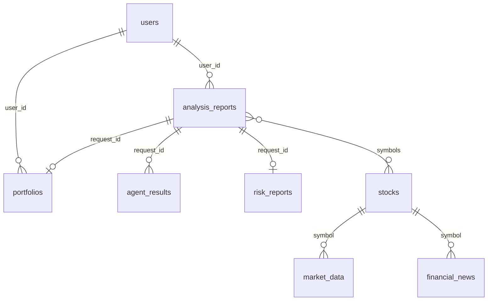
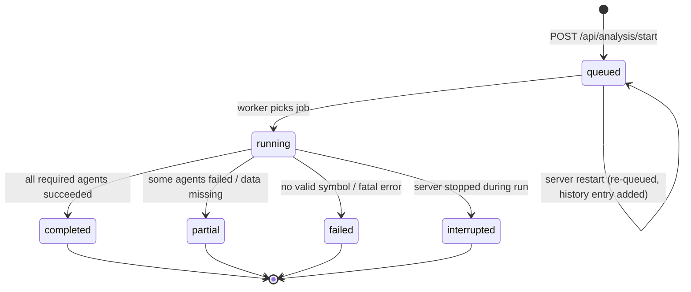

# NeuralVest — Database Design

> **Status:** Phase 0 design document (no implementation yet). **Revision 2**: review corrections applied.
> **Database:** MongoDB Atlas Free cluster (M0) · database name `neuralvest_db`
> **Driver:** PyMongo (synchronous) · application-level validation with Pydantic (`backend/app/database/models.py`) · database-level validation with MongoDB `$jsonSchema` validators
> **Last updated:** 2026-11-23

---

## 1. Design Principles

1. **MongoDB Atlas is the only application database.** SQLite is allowed only as an optional LangGraph checkpoint file (see [architecture.md §7](architecture.md#7-background-execution-model)).
2. **One authoritative record per fact.** Each kind of data has exactly one source of truth (§2.1). Other collections hold **references** plus small **write-once** summaries, never independently editable copies.
3. **Two layers of validation.** Pydantic models validate in the application. MongoDB `$jsonSchema` validators and unique indexes enforce the essential rules **inside the database**, even for code paths that bypass Pydantic (§5).
4. **No duplicates.** Natural keys are protected by unique indexes on fields that are **never null** (§3.5). Writes use upserts.
5. **Provenance everywhere.** External data carries `source` and a fetch/as-of timestamp. Configured assumptions such as the risk-free rate are stored with their value, date and source.
6. **Timestamps in UTC** (`datetime` with timezone) in the database. The UI converts them to IST.
7. **Money and prices** are stored as `double`. They are illustrative analytics values, not ledger amounts.
8. **Pagination** on every list query (`skip`/`limit`, maximum `limit` 100).
9. **Job status is never silently lost.** Every status change is appended to a status history (§6).
10. **Secrets** (the connection URI) live only in `backend/.env`.

### Fields added beyond the specification

The specification lists the core fields of each collection. The **operational fields** below are needed to meet other requirements in the specification (background execution and polling, provenance, deduplication, reproducibility). They add no features.

| Collection | Added field(s) | Why it is needed |
|---|---|---|
| `analysis_reports` | `status`, `status_history`, `request_params`, `interrupted_reason`, `retry_of`, `error_summary`, `requested_at`, `completed_at` | Background execution + polling (spec §11); recovery after restarts (§6) |
| `agent_results` | `scope`, `scope_key`, `attempts`, `status_detail`, `llm_model`, `updated_at` | Never-null unique key (§3.5); retries; Agent Monitoring page shows errors and the model used |
| `financial_news` | `category`, `relevance`, `fetched_at`, `url_hash` | Categories and relevance are Agent 2 outputs; `url_hash` gives deduplication |
| `risk_reports` | `risk_free_rate` (`value_pct`, `as_of_date`, `source`) | Reproducible Sharpe ratios (decision D4) |
| all | `schema_version` (int) | Allows documents to evolve safely across phases |

---

## 2. Entity Relationships and Source of Truth



### 2.1 Which collection is authoritative

| Data | **Authoritative collection** | Other places it appears | What those places hold |
|---|---|---|---|
| Full output of each agent run | **`agent_results`** | `analysis_reports.*_analysis` | A **reference** (`agent_result_id`s) + a small **headline summary** copied once at report time |
| Daily prices | **`market_data`** | `agent_results` (Market Research output) | Indicator values and trend only; **no price series** (charts read `market_data` via `/api/stocks/{symbol}/history`) |
| News articles + sentiment + summary | **`financial_news`** | `agent_results` (News output) | `url_hash` references + the digest and sentiment counts |
| Risk metrics of a request | **`agent_results`** (Risk Assessment output) | `risk_reports` | A **write-once, query-friendly projection** of the same numbers, required by the specification |
| Portfolio allocation of a request | **`agent_results`** (Portfolio output) | `portfolios` | A **write-once projection**: allocations, amount, method, key metrics. The equity curve stays in `agent_results`. |
| Report narrative (final summary, key observations, limitations, sources) | **`analysis_reports.final_summary`** | — | Exists only here |
| Company profile + latest fundamentals snapshot | **`stocks`** | `agent_results` (Stock Analysis output) | `stocks` is the *latest* snapshot per company; `agent_results` keeps the per-request version |

### 2.2 Write rules that prevent competing versions

1. **Agents write only to `agent_results`** (plus the data collections `market_data`, `financial_news`, `stocks`).
2. **Projections are derived, never edited.** `risk_reports`, `portfolios` and the summaries inside `analysis_reports` are produced **once** by the report-generation step, from the `agent_results` documents of the same `request_id`. Each projection stores `source_agent_result_ids`.
3. **Immutable after completion.** Once a request reaches a terminal status (`completed`, `partial`, `failed`, `interrupted`), its `agent_results` and projections are never updated again. A re-run creates a **new `request_id`** (`retry_of` points to the old one).
4. If a projection and its source ever disagree, for example after a manual edit, **`agent_results` wins**. The integrity check (§5.3) reports the mismatch.

---

## 3. Collections

### 3.1 `users`

| Field | Type | Rules |
|---|---|---|
| `_id` | ObjectId | Mongo default |
| `user_id` | string | uuid4 hex, **unique** |
| `name` | string | 1–80 chars |
| `email` | string | lower-cased, valid email, **unique** |
| `password_hash` | string | Argon2 hash (pwdlib). **No plaintext password is ever stored.** |
| `created_at` / `updated_at` | datetime | UTC |
| `schema_version` | int | |

**Indexes:** `{user_id: 1}` unique · `{email: 1}` unique

```json
{
  "user_id": "3f2a...", "name": "Example User", "email": "user@example.com",
  "password_hash": "$argon2id$v=19$m=65536,t=3,p=4$...",
  "created_at": "2026-11-23T05:00:00Z", "updated_at": "2026-11-23T05:00:00Z", "schema_version": 1
}
```

### 3.2 `stocks`

| Field | Type | Rules |
|---|---|---|
| `symbol` | string | Normalized Yahoo-style ticker, e.g. `RELIANCE.NS`, `500325.BO`, **unique** |
| `company_name` | string | |
| `exchange` | string | `NSE` \| `BSE` |
| `sector` / `industry` | string \| null | |
| `company_information` | object | Summary info + **latest** fundamentals snapshot from Agent 3 (ratios as `{value, reason}`, statement periods, source) |
| `updated_at` | datetime | |

**Indexes:** `{symbol: 1}` unique · text index `{company_name: "text", symbol: "text"}` for `/api/stocks/search` (fallback: case-insensitive prefix regex)

### 3.3 `market_data`

One document per **symbol per trading day** (also used for the benchmark `^NSEI`). This is the **only** place price history is stored.

| Field | Type | Rules |
|---|---|---|
| `symbol` | string | |
| `date` | datetime | Trading date at 00:00 UTC |
| `open`, `high`, `low`, `close`, `adjusted_close` | double | all > 0; `low ≤ open, close ≤ high` |
| `volume` | int64 | ≥ 0 |
| `source` | string | e.g. `"yahoo_finance_via_yfinance"` |
| `fetched_at` | datetime | |

**Indexes:** `{symbol: 1, date: 1}` **unique** (prevents duplicate days; supports range queries)

**Write pattern:** `bulk_write` of `UpdateOne(..., upsert=True)` in batches. One year for one symbol is about 250 upserts in a single round trip, well under the 100 ops/sec limit.

> yfinance note: call `history(..., auto_adjust=False)` so that both `close` and `adjusted_close` (`Adj Close`) are available.

### 3.4 `financial_news`

| Field | Type | Rules |
|---|---|---|
| `symbol` | string | |
| `headline` | string | |
| `publisher` | string | |
| `article_url` | string | `http`/`https` only; validated |
| `url_hash` | string | SHA-256 of the normalized URL |
| `publication_date` | datetime \| null | |
| `sentiment` | string | `positive` \| `negative` \| `neutral` \| `uncertain` |
| `summary` | string | LLM summary (≤ 300 chars) |
| `category` | string | Allowed category list (architecture §5.2) |
| `relevance` | string | `high` \| `medium` \| `low` |
| `source` | string | `gdelt` \| `rss:<feed-name>` |
| `fetched_at` | datetime | |

**Indexes:** `{symbol: 1, url_hash: 1}` **unique** · `{symbol: 1, publication_date: -1}` (latest news) · `{sentiment: 1, publication_date: -1}` (News page filter)

Full article text is **not** stored. Storing it would raise copyright and storage problems.

### 3.5 `agent_results` (authoritative agent outputs)

One document per **agent × scope × request**.

| Field | Type | Rules |
|---|---|---|
| `request_id` | string | required |
| `agent_name` | string | `market_research` \| `financial_news` \| `stock_analysis` \| `risk_assessment` \| `portfolio_optimization` |
| `scope` | string | `symbol` (result for one stock) \| `request` (result for the whole request, e.g. portfolio, correlation) |
| `scope_key` | string | **Never null.** The symbol when `scope = "symbol"`, the literal `"__request__"` when `scope = "request"` |
| `symbol` | string \| null | Kept for readability and queries; `null` when `scope = "request"`. **Not part of the unique key.** |
| `execution_status` | string | `pending` \| `running` \| `completed` \| `partial` \| `failed` \| `skipped` \| `interrupted` |
| `attempts` | int | Incremented on each retry of the **same** run (retries update this document; they do not insert new ones) |
| `input_summary` | object | Small summary of inputs (never secrets) |
| `output` | object | The agent's output contract (architecture §5). **No price series.** |
| `status_detail` | object | `{warnings: [], errors: []}` |
| `llm_model` | string \| null | |
| `execution_time` | double | seconds |
| `created_at` / `updated_at` | datetime | |

**Indexes:** `{request_id: 1, agent_name: 1, scope_key: 1}` **unique** · `{agent_name: 1, created_at: -1}` · `{symbol: 1, agent_name: 1, created_at: -1}` (latest analysis per stock)

**Why `scope_key` instead of `symbol` in the unique index.** In MongoDB, a unique index treats a missing field and `null` as the value `null`. If `symbol` were in the key, only **one** null-symbol document could exist per `(request_id, agent_name)`. That happens to suit today's design, but it is fragile: a missing field caused by a bug would collide silently with a real portfolio-level row, and future request-level results could be rejected. A dedicated, always-present `scope_key` avoids that. A partial index is not needed.

Examples for one portfolio request with 2 stocks:

| agent_name | scope | scope_key | symbol |
|---|---|---|---|
| market_research | symbol | `TCS.NS` | `TCS.NS` |
| market_research | symbol | `INFY.NS` | `INFY.NS` |
| risk_assessment | symbol | `TCS.NS` | `TCS.NS` |
| risk_assessment | request | `__request__` | null |
| portfolio_optimization | request | `__request__` | null |

### 3.6 `risk_reports` (write-once projection)

| Field | Type |
|---|---|
| `request_id` | string |
| `symbols` | array<string> |
| `volatility` | object `{symbol: annualized_pct}` |
| `beta` | object `{symbol: value}` |
| `sharpe_ratio` | object `{symbol: value}` |
| `maximum_drawdown` | object `{symbol: pct}` |
| `correlation` | object (matrix as nested dict) |
| `risk_classification` | object `{symbol: "low"\|"moderate"\|"high", "portfolio"?: ...}` |
| `risk_free_rate` | object **required** `{value_pct, as_of_date, source}`: the exact rate used for every Sharpe ratio in this report |
| `source_agent_result_ids` | array<ObjectId> |
| `created_at` | datetime |

**Indexes:** `{request_id: 1}` unique · `{symbols: 1, created_at: -1}`

The same `risk_free_rate` object is also written into the Risk Assessment output in `agent_results` and into `portfolios.expected_metrics`, because the Sharpe ratio appears in both places.

### 3.7 `portfolios` (write-once projection)

| Field | Type | Rules |
|---|---|---|
| `portfolio_id` | string | uuid4 hex, **unique** |
| `request_id` | string | **unique**; links to the request that produced it |
| `user_id` | string \| null | null before auth exists (Phase 11) |
| `stock_allocations` | array | `[{symbol, weight_pct, amount_inr, shares, last_price}]`; weights sum to 100 ± 0.01 |
| `investment_amount` | double | > 0 |
| `optimization_method` | string | Allowed method list |
| `expected_metrics` | object | Return, volatility, Sharpe, `risk_free_rate`, assumptions, backtest **summary** (no equity curve) |
| `source_agent_result_ids` | array<ObjectId> | |
| `created_at` | datetime | |

**Indexes:** `{portfolio_id: 1}` unique · `{request_id: 1}` unique · `{user_id: 1, created_at: -1}`

### 3.8 `analysis_reports` (job record + report)

Each document is both the **job record** (status, inputs, history) and, once finished, the **report**.

| Field | Type | Rules |
|---|---|---|
| `report_id` | string | uuid4 hex, **unique** |
| `request_id` | string | **unique** |
| `user_id` | string \| null | |
| `symbols` | array<string> | |
| `request_params` | object | Full validated input `{symbols, investment_amount, risk_preference, method, constraints, request_type}`. Allows re-queueing and re-runs. |
| `status` | string | `queued` \| `running` \| `completed` \| `partial` \| `failed` \| `interrupted` |
| `status_history` | array | Append-only `[{status, at, reason}]` |
| `interrupted_reason` | string \| null | `server_restart_during_run` (see §6) |
| `retry_of` | string \| null | `request_id` of the interrupted/failed request this one re-runs |
| `market_analysis`, `news_analysis`, `fundamental_analysis`, `risk_analysis`, `portfolio_analysis` | object \| null | Each `{agent_result_ids: [...], headline: {...}}`. The headline is a small, write-once summary (e.g. trend, RSI, sentiment counts, risk class) for list views. Full data lives in `agent_results`. |
| `final_summary` | object | Report narrative: key observations, data limitations, source references (authoritative here) |
| `error_summary` | array | |
| `requested_at`, `generated_at`, `completed_at` | datetime | |

**Indexes:** `{report_id: 1}` unique · `{request_id: 1}` unique · `{user_id: 1, requested_at: -1}` (Reports page, paginated) · `{status: 1, requested_at: 1}` (startup recovery and queue order)

**Reading a full report:** `GET /api/reports/{report_id}` loads the report document plus its `agent_results` (one indexed query by `request_id`) and assembles the response.

---

## 4. Storage Estimate vs. the 512 MB Free Limit

The Atlas free tier limit of **512 MB covers stored data and indexes**. To stay on the safe side, the estimate below uses **uncompressed BSON document size plus index size**. Atlas's on-disk storage is compressed and is likely smaller. The numbers are design estimates, and real sizes are measured with `dbStats` from Phase 2 onwards.

### 4.1 What is included

| Included | Not included / uncertain |
|---|---|
| BSON size of every document (field names count, since MongoDB stores them in each document) | Atlas's internal system data and metadata for the cluster (managed by Atlas; not documented as counting toward the limit, so not assumed either way) |
| All secondary indexes **plus the `_id` index** of every collection | Compression gains (ignored, so the estimate leans high) |
| ~25% allowance for per-collection overhead, padding and index fragmentation | |
| Growth from repeated analyses (§4.3) | |

### 4.2 Base data (does not grow with the number of analyses)

| Collection | Assumption | Docs | Data | Indexes | Total |
|---|---|---|---|---|---|
| `market_data` | 60 symbols (NIFTY 50 + extras + benchmark) × 5 years × ~250 days; ~220 B/doc; 2 indexes ~70 B/doc | 75,000 | 16.5 MB | 5.3 MB | **~22 MB** |
| `financial_news` | 60 symbols × ~200 articles; ~1 KB/doc; 4 indexes ~200 B/doc | 12,000 | 12 MB | 2.4 MB | **~14 MB** |
| `stocks`, `users` | small | < 1,000 | < 2 MB | < 0.5 MB | **~2 MB** |
| **Base subtotal** | | | | | **~38 MB** |

### 4.3 Growth per analysis

| Item | Per single-stock analysis | Per 5-stock portfolio analysis |
|---|---|---|
| `agent_results` (no price series) | 4 docs × 4–10 KB ≈ 16–40 KB | ~22 docs ≈ 90–200 KB (includes equity curve ~20 KB) |
| `analysis_reports` (references + headlines + narrative) | 6–12 KB | 10–20 KB |
| `risk_reports` + `portfolios` | 2–3 KB | 6–10 KB |
| Index entries (5 collections) | ~1–2 KB | ~3–5 KB |
| **Total per analysis** | **~25–57 KB** | **~110–235 KB** |

### 4.4 Totals (including the 25% overhead allowance)

| Scenario | Calculation | Estimate | % of 512 MB |
|---|---|---|---|
| Base only | 38 MB × 1.25 | ~48 MB | ~9% |
| + 500 analyses (mixed: 80% single, 20% portfolio) | (38 + 500 × ~70 KB ≈ 35 MB) × 1.25 | **~91 MB** | ~18% |
| + 1,000 analyses (mixed) | (38 + ~70 MB) × 1.25 | **~135 MB** | ~26% |
| + 2,000 analyses, all worst-case portfolio | (38 + 2,000 × 235 KB ≈ 470 MB) × 1.25 | ~635 MB | **exceeds limit** |

So typical academic use (up to ~1,000 mixed analyses) stays at roughly **90–135 MB**, about a quarter of the quota. Heavy repeated portfolio runs could fill it, so growth is monitored and controlled:

### 4.5 Retention and monitoring (configurable)

| Setting (`backend/.env`) | Default | Effect |
|---|---|---|
| `MARKET_DATA_MAX_YEARS` | `5` | Rows older than this are deleted per symbol by the clean-up routine. Any positive integer is allowed. |
| `STORAGE_WARN_PCT` | `60` | The health check warns when `dataSize + indexSize` exceeds this % of 512 MB |
| `STORAGE_BLOCK_PCT` | `85` | Above this %, new analyses are refused with a clear message (HTTP 507) until data is cleaned up. This prevents Atlas from hitting the hard limit mid-write. |

Clean-up of old reports is **manual and explicit** (a documented script that deletes a chosen user's old reports and their `agent_results` by `request_id`). Reports are never deleted automatically.

**TTL indexes:** **none in the initial design.** Every collection holds data the user may come back to, so nothing genuinely needs automatic expiry (spec §8).

---

## 5. Database-Level Safeguards

Pydantic protects only writes that go through the application's repository layer. Scripts, the Atlas Data Explorer, `mongosh` or a future code path could bypass it. These safeguards apply **regardless of how a document is written**:

### 5.1 MongoDB schema validators (`$jsonSchema`)

Every collection is created (or updated with `collMod`) at startup with a validator:

- `validationLevel: "strict"`: applies to all inserts and updates
- `validationAction: "error"`: a non-conforming write is **rejected** with `DocumentValidationFailure`; it is not just logged

The validators enforce the **essentials** and deliberately stay simpler than the Pydantic models, so the two do not drift apart:

| Collection | Database-enforced rules (examples) |
|---|---|
| all | required identity fields present; `schema_version` is an int; timestamps are `date` type |
| `users` | `email` and `password_hash` required strings; `password_hash` must start with `$argon2` (blocks plaintext passwords) |
| `market_data` | `symbol` string, `date` date; prices `double` and `> 0`; `volume` ≥ 0 |
| `financial_news` | `article_url` matches `^https?://`; `sentiment` in the allowed enum |
| `agent_results` | `agent_name`, `scope`, `execution_status` in their enums; `scope_key` required **non-empty string** |
| `analysis_reports` | `status` in the enum; `status_history` is an array; `request_params` is an object |
| `risk_reports` | `risk_free_rate.value_pct`, `.as_of_date`, `.source` required |
| `portfolios` | `investment_amount` > 0; `stock_allocations` non-empty array |

Cross-field rules (e.g. `low ≤ close ≤ high`, weights sum to 100) remain **Pydantic-only**, because `$jsonSchema` cannot express them cleanly. The integrity check covers them (§5.3).

> Atlas free-tier compatibility of `collMod`/validators is **verified in Phase 2** (task 2.3.6). If any option is not permitted, the fallback is to rely on unique indexes + Pydantic + the integrity check, and to document this.

### 5.2 Other database-side protections

- **Unique indexes** (§3) reject duplicates from any writer.
- **Least-privilege database user**: the application's Atlas user gets `readWrite` **only** on `neuralvest_db` and `neuralvest_db_test`, not on every database.
- **Single write path in code**: all application code and project scripts import the repository helpers in `database/`. Project scripts (e.g. clean-up) live in `backend/scripts/` and use the same helpers. This is a convention; the database-level checks enforce what it cannot.

### 5.3 Integrity check

A read-only function and script (`check_integrity`) reports:

- documents that fail the current `$jsonSchema` (found with a `$nor: [{$jsonSchema: ...}]` query, which also catches documents written before a validator was tightened)
- cross-field violations (price ordering, weight sums)
- projections that no longer match their source `agent_results`
- `agent_results` whose `request_id` has no `analysis_reports` document (orphans)

It **reports only**; it never repairs silently. It runs in tests and can be run manually.

---

## 6. Job Status Lifecycle and Recovery

### 6.1 Normal lifecycle



Every transition is appended to `status_history` as `{status, at, reason}`. Nothing is overwritten without a trace.

### 6.2 Startup recovery (replaces "mark everything failed")

The in-memory queue is lost when the server stops, but the database still has each job's `status` and full `request_params`. At startup, in `requested_at` order:

| Found at startup | Meaning | Action | What the user sees |
|---|---|---|---|
| `queued` | Accepted but **never started**; no agent ran | **Re-queued automatically** using `request_params`. Status stays `queued`; history entry `{status: "queued", reason: "requeued_after_restart"}` | Analysis still pending; it runs normally |
| `running` | Interrupted part-way | Status → **`interrupted`**, `interrupted_reason: "server_restart_during_run"`. Agent results that finished are **kept**; agents that were `running`/`pending` → `interrupted` | "Interrupted" badge, the agents that did complete, and a **Re-run** button |

- **Re-run** creates a **new request** (`retry_of` = old `request_id`). The interrupted record stays unchanged as history. Workflows are not resumed half-way, because finished results could be stale by the time the job restarts.
- `interrupted` is a distinct status, not `failed`, so the UI and the Reports page can tell **"something broke"** apart from **"the server was stopped"**.
- If more re-queued jobs exist than the worker can handle quickly, they simply wait in order. With one worker, nothing runs in parallel.

---

## 7. Connection & Reliability

- One `MongoClient` per process (created at startup, closed at shutdown), with `serverSelectionTimeoutMS=5000`, `connectTimeoutMS=10000`, `retryWrites=true`, `maxPoolSize=10`. That is far below the 500-connection limit.
- **Startup sequence:** `ping` → apply validators (§5.1) → create indexes (idempotent) → job recovery (§6.2) → start the worker.
- If Atlas is unreachable, `/api/health/db` reports it and endpoints that need the database return **503** with a clear message. A workflow that cannot persist its results is marked `failed` with the reason `database_unavailable` once the connection returns (or logged locally if it never does).
- Tests use a separate database (`neuralvest_db_test`) on the same free cluster, cleaned up after the tests run.

---

## 8. Environment Variables (database-related)

```dotenv
# backend/.env  (never committed; .env.example holds placeholders)
MONGODB_URI=mongodb+srv://<username>:<password>@<cluster-host>/?retryWrites=true&w=majority
MONGODB_DB_NAME=neuralvest_db
MONGODB_TEST_DB_NAME=neuralvest_db_test
MARKET_DATA_MAX_YEARS=5
STORAGE_WARN_PCT=60
STORAGE_BLOCK_PCT=85
```
