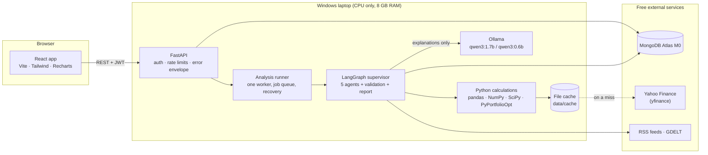
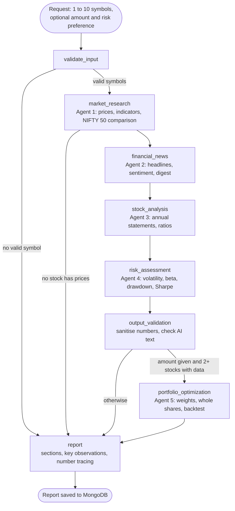
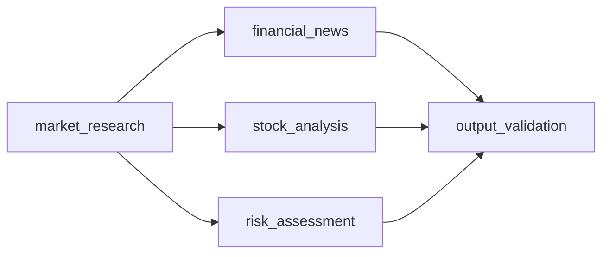
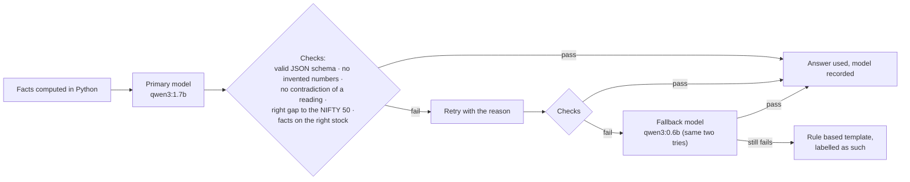
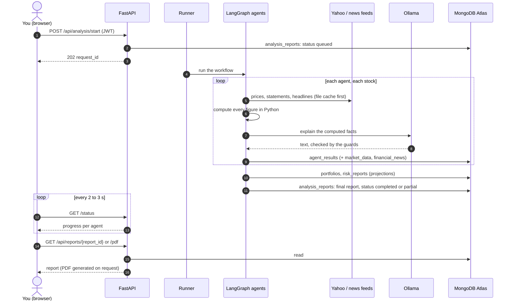
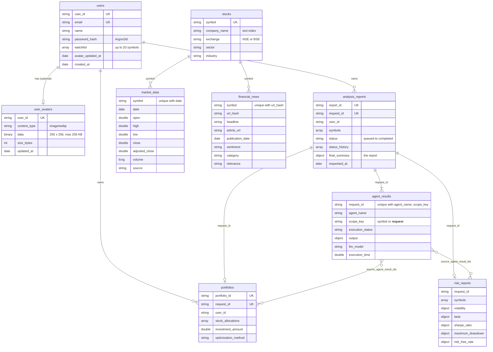

# NeuralVest Diagrams

Four diagrams in Mermaid, which GitHub draws directly. They follow the code: the workflow diagram is based on
the graph LangGraph compiles (`app/orchestration/graph.py`), and the database diagram on the document models
(`app/database/models.py`) and indexes (`app/database/indexes.py`).

1. [System architecture](#1-system-architecture) (task 14.1.2)
2. [Agent workflow (LangGraph)](#2-agent-workflow-langgraph) (task 14.1.3)
3. [Data flow of one analysis](#3-data-flow-of-one-analysis)
4. [Database schema](#4-database-schema) (task 14.1.4)

---

## 1. System architecture

Everything runs on one Windows laptop except MongoDB Atlas and the public data sources.

| Part | Responsibility |
|---|---|
| React app | Pages, charts and report view; keeps the access token in session storage |
| FastAPI | Validation, authentication, ownership checks, rate limits, one error format |
| Analysis runner | Runs one analysis at a time in a background thread; queued jobs survive a restart |
| LangGraph supervisor | Validates input, runs the agents, retries temporary failures, checks the AI text, builds the report |
| Python calculations | Every number in a report (indicators, ratios, risk, optimisation, backtest) |
| Ollama | Plain-language explanations of numbers it is given; never computes or invents figures |
| MongoDB Atlas | Users, prices, news, agent results, portfolios, reports |

---

## 2. Agent workflow (LangGraph)

The default is **sequential** (`AGENT_EXECUTION_MODE=sequential`), which keeps memory low on 8 GB. Dashed
arrows are decisions the supervisor makes from the state.

**Parallel mode** (`AGENT_EXECUTION_MODE=parallel`): after market research, news, stock analysis and risk
assessment run at the same time, and output validation waits for all three. It is faster but needs more
memory, so it is off by default.

### How an AI answer is accepted

Each agent computes its figures first. Only then does it ask the model to explain them, and the answer
must pass every check.

With less free RAM than `LLM_MIN_FREE_RAM_MB` (counting the RAM a loaded primary model already holds), the
client starts at the fallback model.

---

## 3. Data flow of one analysis

---

## 4. Database schema

`agent_results` is the source of truth for everything an agent computed. `portfolios` and `risk_reports` are
write-once projections that point back to it. `analysis_reports` holds the job and the final report.

Every collection also has a strict `$jsonSchema` validator, and every document a `schema_version`. Field
level details and the reasons behind each index are in [database_design.md](database_design.md).
